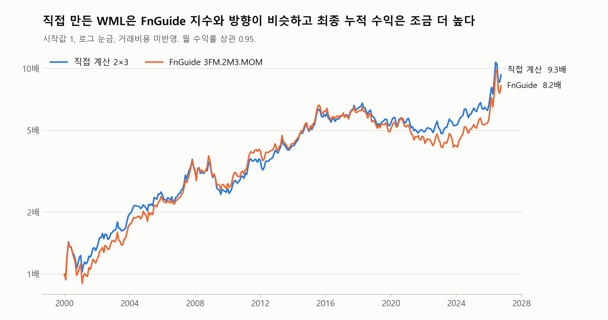
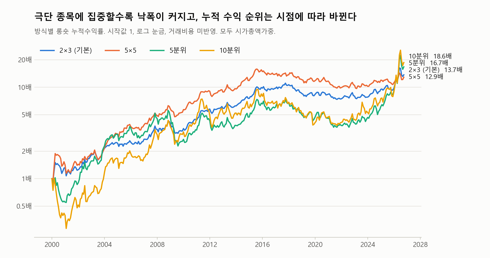
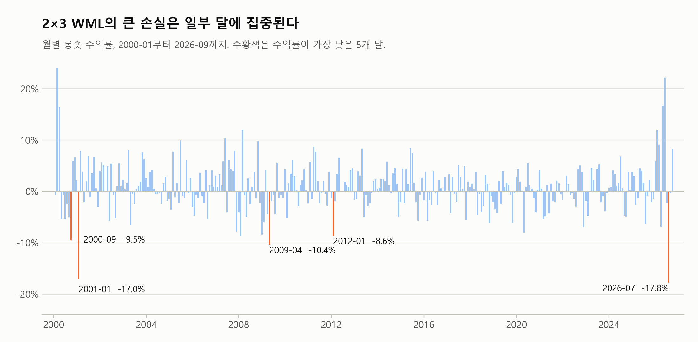

# 모멘텀 붕괴 연구 2. WML 계산과 결과

[README와 목차로 돌아가기](../README.md)

---

## 6. WML 계산과 결과

### 계산 순서

2000-01 수익률을 예로 들면 다음과 같다.

1. **투자 대상 (1999-12 말):** 코스피·코스닥 종목 중 거래정지, 관리종목, 스팩이 아니고 시가총액이 있는 종목. 금융업은 포함한다.
2. **모멘텀 점수:** 직전 1개월을 뺀 그 전 11개월의 누적수익률이다(12−1 모멘텀). 1999-12 말 구성이면 1999-01부터 1999-11까지 수익률을 쓴다. 직전 달을 빼는 이유는 단기 반전 효과 때문이다.
3. **바구니 나누기:** 1999-12 말의 시가총액과 점수로 나눈다. 경계는 코스피 종목으로 계산하고, 코스닥 종목도 같은 경계로 넣는다.
4. **보유 수익률:** 각 바구니의 2000-01 수익률을 1999-12 말 시가총액으로 가중 평균한다.
5. **WML:** 승자 쪽 − 패자 쪽.

매달 다시 구성하고 1개월 보유하며, 2026-09까지 반복한다.

**무투자인데 왜 가중평균을 하는가.** 가중평균은 승자 쪽과 패자 쪽 안에서 각각 한다. 승자 쪽을 1원 사고 패자 쪽을 1원 공매도하므로 순투자금은 0원이다. 아래는 가상 예시다.

| 단계 | 계산 |
|---|---|
| 승자 쪽 1원 매수 | A(시총 800억) +10%, B(200억) −5% → 0.8 × 10 + 0.2 × (−5) = **+7%** |
| 패자 쪽 1원 공매도 | C(시총 500억) +4%, D(500억) +2% → **+3%** |
| WML | 7% − 3% = **+4%** |

2×3은 여기에 한 단계가 더 있다. 소형 승자와 대형 승자를 각각 시총가중한 뒤 둘을 절반씩 평균한다. 패자 쪽도 같다.

### 4가지 방식

| 방식 | 역할 | 바구니 | 승자 쪽 (= 롱온리) | 패자 쪽 |
|---|---|---|---|---|
| **2×3** | 기본 | 크기 2(코스피 중앙값) × 모멘텀 3(코스피 30%·70%) | (소형 승자 + 대형 승자) ÷ 2 | (소형 패자 + 대형 패자) ÷ 2 |
| **5×5** | 강건성 확인 | 크기 5 × 모멘텀 5 | 크기 그룹별 최상위의 평균 | 크기 그룹별 최하위의 평균 |
| **5분위** | 강건성 확인 | 모멘텀 5 | 상위 20% | 하위 20% |
| **10분위** | 강건성 확인 | 모멘텀 10 | 상위 10% | 하위 10% |

- **역할은 결과를 보기 전에 정했다.** 여러 방식을 만들고 결과가 좋은 것을 고르면 우연히 좋게 나온 방식을 고를 위험이 크기 때문이다. 붕괴 정의, 지표 시험, 모델 선택은 2×3으로 하고, 나머지는 **결론이 방식을 바꿔도 유지되는지 보는 강건성 확인**에만 쓴다.
- **2×3을 기본으로 한 이유:** 성과가 가장 좋아서가 아니라, FnGuide와 비교할 수 있고 학계에서 쓰는 구성이기 때문이다.
- **방식의 출처:** 모멘텀 효과는 Jegadeesh & Titman (1993)이 보고했다. 2×3과 5×5의 구성은 Fama & French (2012)의 크기·모멘텀 정렬을 따랐고, 10분위는 Barroso & Santa-Clara (2015), Huang (2022)의 시총가중 10분위와 같은 구조다. 직전 달을 건너뛰는 12−1 점수도 Fama & French (2012)가 표준이라고 설명한다. 5분위는 강건성 확인을 위해 추가했다.
- **논문과 다른 점:** 논문은 NYSE나 대형주 기준으로 경계를 잡고, Fama & French (2012)의 크기 기준은 시가총액 상위 90%다. 우리는 코스피 종목으로 경계를 잡고, 크기는 종목 수의 중앙값으로 나눈다. Fama & French (2012)는 5×5의 25개 포트폴리오를 회귀의 설명 대상으로 쓰며, 롱숏 수익률로 만든 것은 우리 쪽 선택이다.
- **경계를 코스피 기준으로 잡는 이유:** 코스닥은 투자 대상 종목 수의 평균 59%이지만 시가총액은 13%다. 전체 종목으로 경계를 잡으면 수가 많은 소형 종목에 경계가 좌우된다. Fama & French (2012)가 같은 이유로 NYSE 기준을 쓰므로, 한국에서는 코스피를 이에 대응시켰다. FnGuide 지수와도 더 가까워진다(2×3 상관 0.901에서 0.949). 성과가 좋아져서 바꾼 것은 아니며, 2×3 월평균은 0.94%에서 0.81%로 낮아진다. 전체 종목 기준은 강건성 확인으로 함께 보고한다.
- **경계를 코스피로 잡으면 소형 쪽 종목이 많아진다.** 코스닥 종목 대부분이 코스피 중앙값보다 작기 때문이다. 2×3의 평균 종목 수는 소형 패자 473, 소형 승자 284, 대형 패자 138, 대형 승자 208이다. 바구니 안에서는 시가총액으로 가중하므로 종목 수가 많아도 작은 종목의 비중은 작다.
- **동일가중은 만들지 않았다.** 초소형주의 영향이 커지고 실제로 투자하기 어렵기 때문이다.

### 검증: FnGuide 모멘텀 지수와 비교

전체 기간(321개월) 기준이다.

| 방식 | FnGuide 지수 | 상관 | 직접 계산 월평균 | FnGuide 월평균 | 차이의 NW t |
|---|---|---|---|---|---|
| 2×3 | `3FM.2M3.MOM` | 0.949 | 0.81% | 0.79% | 0.13 |
| 5×5 | `3FM.5M5.MOM` | 0.939 | 0.84% | 0.93% | −0.89 |

두 방식 모두 상관이 약 0.95이고 평균 차이도 유의하지 않다. 다만 추적오차가 월 1.70%, 1.93%로, 완전히 같은 수익률은 아니다. 2×3의 누적수익은 직접 계산 9.3배, FnGuide 8.2배다.

**추적오차가 생기는 이유.** FnGuide의 구성 규칙을 확인하지 못해 단정할 수 없다. 설정을 바꿔 시험해 보면 분위 경계의 영향이 가장 크다. 2×3의 경계를 전체 종목으로 잡으면 상관 0.901, 추적오차 2.30%인데, 코스피 종목으로 잡으면 0.949, 1.70%가 된다. 그래서 FnGuide도 코스피 기준을 쓸 가능성이 있다고 추정한다. 관리종목 포함, 코스피 단독, 점수 기간 변경은 더 멀어지고, 거래정지 포함과 상폐 미반영 보유는 거의 같다. 남은 차이는 구성 시점이나 배당 포함 여부 등에서 올 수 있으나 확인하지 못했다. 추적오차는 2000년, 2021년, 2026년처럼 시장이 크게 움직인 해에 약 3%로 크고, 2015년부터 2017년까지는 약 1%로 작다.

**5분위와 10분위는 비교할 FnGuide 지수가 없어 외부 검증 없이 만든 결과다.** 2×3, 5×5와 같은 코드로 계산했고, 바구니 배정 합과 상관을 확인했다. 5분위와 10분위의 상관은 0.93, 10분위와 2×3의 상관은 0.83이다.

### 성과: 전체 기간 롱숏

- **NW t:** 수익률의 자기상관을 보정한 t값이다.
- **최대낙폭:** 누적수익률이 고점에서 가장 크게 떨어진 비율이다.
- **샤프:** 월평균 ÷ 월 표준편차 × √12. 롱숏은 순투자금이 0원이라 무위험수익률을 빼지 않는다.

| 방식 | 월평균 | NW t | 샤프 | 최대낙폭 | 최악의 달 |
|---|---|---|---|---|---|
| 2×3 | 0.81% | 3.17 | 0.60 | −32.4% | −17.8% |
| 5×5 | 0.84% | 2.75 | 0.55 | −38.1% | −25.2% |
| 5분위 | 1.11% | 2.46 | 0.51 | −55.1% | −25.3% |
| 10분위 | 1.26% | 2.22 | 0.47 | −67.9% | −28.6% |

**강건성: 경계를 전체 종목으로 잡은 경우**

| 방식 | 월평균 | NW t | 샤프 | 최대낙폭 | 최악의 달 | 코스피 기준과의 상관 |
|---|---|---|---|---|---|---|
| 2×3 | 0.94% | 3.36 | 0.65 | −33.5% | −18.7% | 0.924 |
| 5×5 | 0.94% | 2.78 | 0.59 | −39.2% | −19.0% | 0.940 |
| 5분위 | 1.19% | 2.41 | 0.52 | −59.2% | −23.5% | 0.924 |
| 10분위 | 1.43% | 2.42 | 0.48 | −71.6% | −32.9% | 0.875 |

### 성과: 구간별 롱숏

표의 괄호는 NW t다.

| 방식 | 2000-01부터 2012-12까지 | 2013-01부터 2026-09까지 |
|---|---|---|
| 2×3 | 1.01% (2.58) | 0.62% (1.89) |
| 5×5 | 1.27% (2.37) | 0.44% (1.45) |
| 5분위 | 1.01% (1.55) | 1.21% (1.99) |
| 10분위 | 1.25% (1.44) | 1.28% (1.77) |

2×3을 [8절](<4_연구설계.md>)의 선택 기간과 검증 기간으로 나누면 다음과 같다.

| 구간 | 월평균 (NW t) | 최악의 달 | 삼성전자·SK하이닉스 제외 월평균 (NW t) |
|---|---|---|---|
| 선택 기간 (2005-07부터 2015-12까지) | 0.81% (2.18) | −10.4% (2009-04) | 0.77% (2.14) |
| 검증 기간 (2016-01부터 2026-09까지) | 0.46% (1.23) | −17.8% (2026-07) | 0.18% (0.58) |
| 2016-01부터 2025-12까지 | 0.15% (0.61) | −8.0% (2020-04) | 0.03% (0.10) |

### 누적수익률과 2026년의 영향

2025년까지 대부분의 기간에는 5×5의 누적수익이 가장 높았지만, 2026년 급등으로 순위가 바뀌었다. 극단 종목에 집중한 방식일수록 2026년 영향이 크다.

| 방식 | 2025-12까지 누적 | 2026년 배수 | 2026-09까지 누적 | 2025-12까지 월평균 (NW t) | 2026-05 수익률 |
|---|---|---|---|---|---|
| 2×3 | 6.6배 | 1.41배 | 9.3배 | 0.70% (2.99) | +22.1% |
| 5×5 | 7.7배 | 1.25배 | 9.7배 | 0.78% (2.55) | +10.9% |
| 5분위 | 7.8배 | 1.87배 | 14.6배 | 0.88% (2.23) | +46.9% |
| 10분위 | 7.4배 | 2.01배 | 14.7배 | 0.99% (1.94) | +56.3% |

2025년 말까지만 보면 10분위를 뺀 세 방식의 NW t가 1.96보다 높고, 월평균은 모두 전체 기간보다 작다.

**2026년 급등의 원인은 삼성전자와 SK하이닉스다.** 2026-05 10분위 승자 쪽에서 두 종목의 비중이 63%이고, 수익률 43.3% 중 37.2%p를 두 종목이 냈다. 두 종목을 빼면 승자 쪽 수익률은 16.4%이고, 승자 쪽 종목의 수익률 중앙값은 −13.7%다. 두 종목의 월 수익률(삼성전자 +43.8%, SK하이닉스 +81.4%)은 일별 수익률을 이어 붙인 값과 같고, 같은 달 코스피 지수도 +28.5%, 직접 만든 시장도 +24.4%, FnGuide 모멘텀 지수도 +25.7%다.

### 성과: 롱온리와 패자 쪽

시장 수익률은 투자 대상 전체의 시가총액가중 수익률이다. 전체 기간 월평균 0.88%, 샤프 0.30, 최대낙폭 −52.7%다. 롱온리와 시장의 샤프는 실제로 돈을 넣는 전략이므로, 그달 초에 아는 전월 말 CD 91일물 ÷ 12를 빼고 계산한다.

| 방식 | 롱온리 월평균 | 샤프 | 최대낙폭 | 시장과의 차이 (NW t) | 후반 시장과의 차이 (NW t) | 패자 쪽 월평균 |
|---|---|---|---|---|---|---|
| 2×3 | 1.30% | 0.48 | −55.7% | 0.42% (1.71) | 0.09% (0.33) | 0.50% |
| 5×5 | 1.23% | 0.40 | −56.8% | 0.35% (0.95) | −0.08% (−0.21) | 0.39% |
| 5분위 | 1.38% | 0.46 | −54.6% | 0.50% (2.63) | 0.48% (1.86) | 0.27% |
| 10분위 | 1.47% | 0.43 | −62.6% | 0.59% (2.14) | 0.68% (1.91) | 0.21% |

**주의:** 2×3과 5×5의 롱숏은 같은 크기 그룹 안에서 승자 − 패자를 구한 뒤 평균하므로 크기 효과가 상쇄된다. 하지만 승자 쪽만 따로 보면 소형과 대형을 절반씩 담은 포트폴리오다. 시장에서 소형 쪽의 시총 비중은 평균 6.4%이므로, 승자 쪽과 시장의 차이에는 모멘텀 효과 외에 소형주를 많이 담은 효과도 섞여 있다. 그래서 2×3의 승자 쪽을 소형과 대형을 절반씩 담은 시장과도 비교했다. 일반 시장과의 차이는 0.42%(NW t 1.71)로 유의하지 않지만, 크기를 맞춘 시장과의 차이는 0.33%(NW t 2.92)로 유의하다. 2013년 이후에는 각각 0.09%(NW t 0.33), 0.21%(NW t 1.55)로 어느 쪽도 유의하지 않다. Fama & French (2012)도 모멘텀 수익이 소형주에서 더 크다고 보고한다.

### 방식별 최악의 달 5개 (롱숏)

| 방식 | 최악의 달 |
|---|---|
| 2×3 | 2026-07 −17.8%, 2001-01 −17.0%, 2009-04 −10.4%, 2000-09 −9.5%, 2012-01 −8.6% |
| 5×5 | 2001-01 −25.2%, 2026-07 −16.8%, 2000-09 −13.4%, 2009-04 −10.8%, 2012-01 −10.1% |
| 5분위 | 2026-07 −25.3%, 2008-01 −19.2%, 2009-04 −18.5%, 2000-06 −17.1%, 2001-01 −16.7% |
| 10분위 | 2001-01 −28.6%, 2026-07 −25.5%, 2000-06 −23.2%, 2019-10 −23.0%, 2009-04 −20.6% |

### 한계와 주의점

- **실제 투자 성과가 아니다.** 거래비용을 반영하지 않았다. 롱숏 수익률은 공매도 금지 기간과 대여 비용을 반영하지 않고, 패자를 언제나 공매도할 수 있다고 가정해 계산했다. 실제 투자 가능성을 볼 때 롱온리를 함께 보는 이유다.
- **최근 성과가 약하다.** 후반에는 대부분의 방식에서 유의하지 않고, 검증 기간의 2×3은 NW t 1.23이다. 앞으로의 성과를 낙관하기 어렵다.
- **결과가 일부 달에 민감하다.** 2026년의 큰 수익이 전체 기간의 평균과 누적수익을 끌어올렸다. 예를 들어 10분위의 월평균은 2025년 말까지 0.99%, 2026-09까지 1.26%다. 시가총액가중이라 삼성전자와 SK하이닉스 같은 초대형주의 영향이 특히 크다. 2×3 대형 승자 안에서 상위 2종목의 비중은 2024-12의 20.0%에서 2026-07의 60.3%로 늘었다.
- **붕괴의 원인이 항상 패자 급등은 아니다.** 2×3의 2026-07(−17.8%)은 패자 쪽이 −1.8%인데 승자 쪽이 −19.6%로, 승자 하락 때문에 깨졌다. 같은 달 삼성전자는 −21.4%, SK하이닉스는 −35.2%, 시장은 −22.3%다. 붕괴를 정의하고 원인을 볼 때 이 점을 함께 봐야 한다.
- **5×5는 바구니가 얇은 달이 있다.** 바구니 25개를 321개월 동안 나눴으므로 바구니별 종목 수는 25 × 321 = 8,025번 센다. 그중 10종목 미만이 55번이고, 가장 적을 때는 1종목이다. 이런 달에는 바구니 수익률이 사실상 몇 종목의 수익률이 된다. 55번 중 32번은 가장 큰 패자 바구니(크기5·모멘텀1), 13번은 가장 작은 승자 바구니(크기1·모멘텀5)이고, 시기로는 21번이 2002년이다.
- **큰 월 수익률:** 월 +300% 초과가 201칸 있고, 그중 107칸이 투자 대상의 보유 수익률에, 89칸이 WML 바구니에 들어가 그대로 두었다. 201칸 모두 일별 수익률을 이어 붙인 값과 1%p 이내로 같고, 투자 대상의 107칸에는 하루 +30%를 넘는 날이 없어 여러 날에 걸친 상승이다. 모두 빼도 2×3 월평균은 0.81%에서 0.79%로 거의 변하지 않지만, 10분위의 2001-01은 −28.6%에서 −34.1%로 달라지는 등 일부 붕괴 달의 크기가 바뀔 수 있다.
- **시가총액이 일시적으로 작게 나올 수 있다.** 확인한 칸 중 3개는 가격이 하루에 크게 조정된 뒤에도 상장주식수가 그대로여서 시가총액이 작아졌다. 시가총액은 가중치와 대형/소형 구분에 쓰이므로 영향을 점검했다. 일시적으로 작게 나온 경우를 찾아 보정해도(투자 대상 종목·월의 0.14%) 2×3 월평균은 0.805%에서 0.802%로 거의 변하지 않고, 네 방식의 최악의 달 5개도 같아 보정하지 않았다. 일별 시가총액으로 다시 찾으면 투자 대상의 0.17%이고, 이를 보정해도 2×3 월평균은 0.805%에서 0.803%로 변하지 않으며 네 방식의 최악의 달 5개도 같다.
- **수익률을 윈저화하지 않았다.** 극단값을 누르면 연구 대상인 붕괴 자체가 작아질 수 있기 때문이다.
- **수익률이 중간에 끊긴 종목이 13개 있다.** 10개는 끊기기 직전 달에 거래정지·관리종목이거나 코넥스여서 투자 대상이 아니었다. 상폐 종목 4개는 모두 상폐 수익률이 반영되어 있다. 다음 달 수익률이 없어 그달 계산에서 빠진 사례는 [5절](<1_데이터.md>)의 2개다.

---

**이전 문서:** [데이터 (1절부터 5절까지)](<1_데이터.md>)  
**다음 문서:** [코드 실행 방법 (7절)](<3_코드실행.md>)
