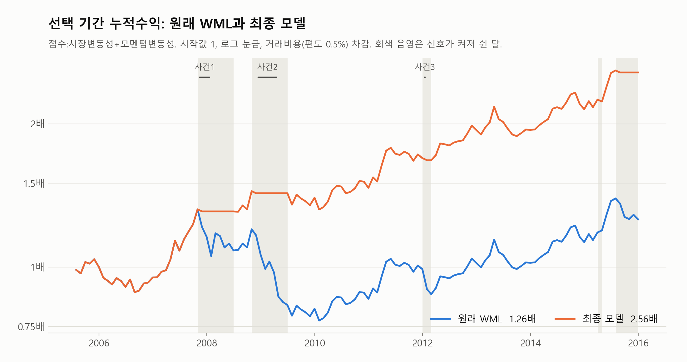
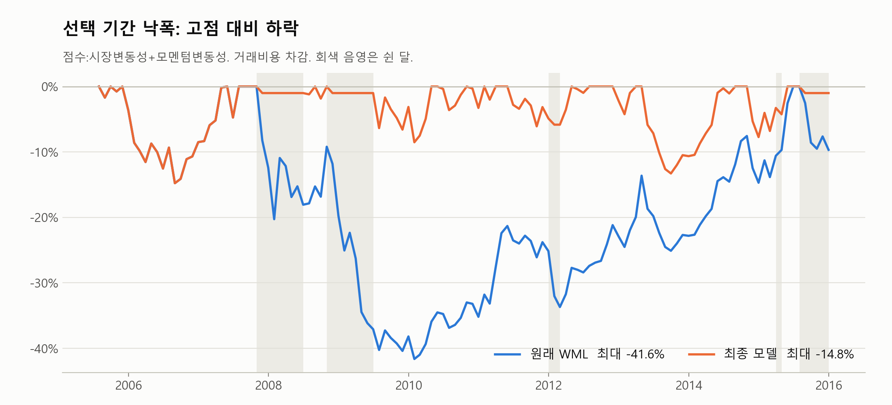
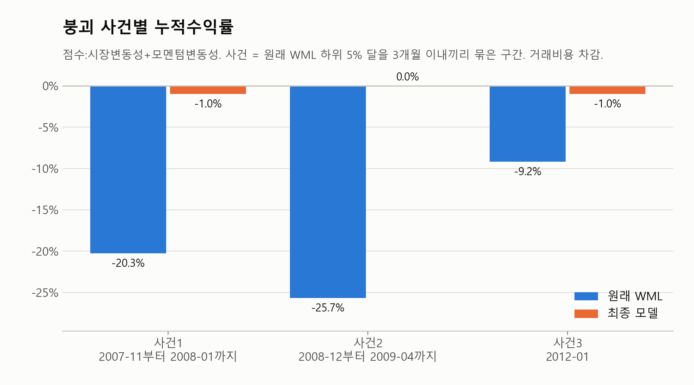
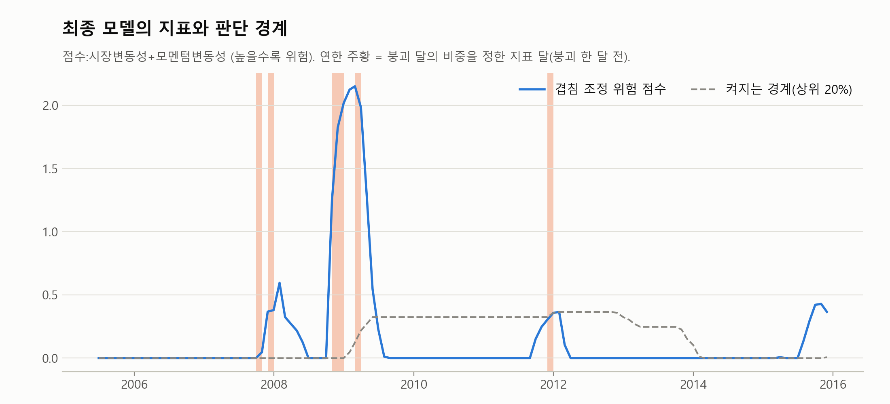
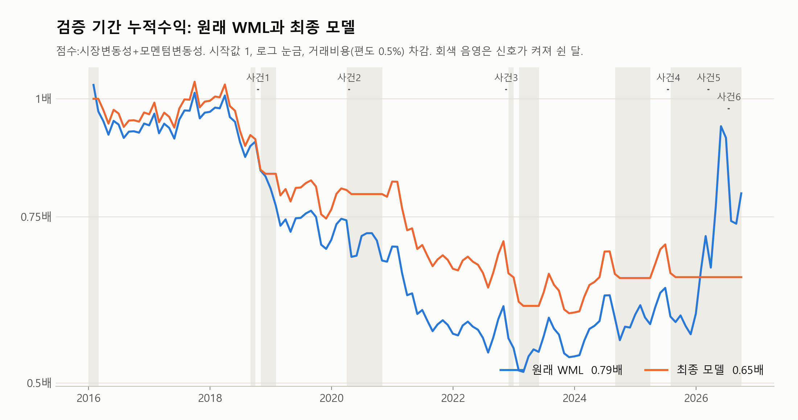
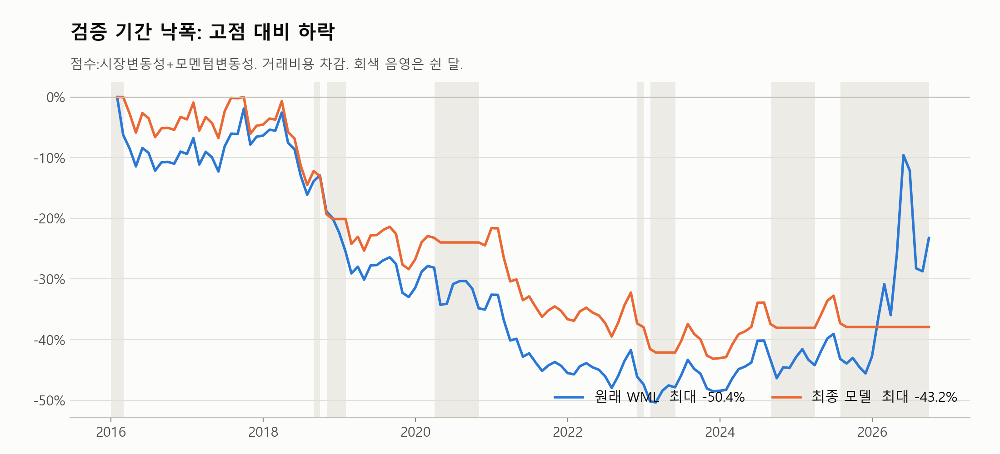
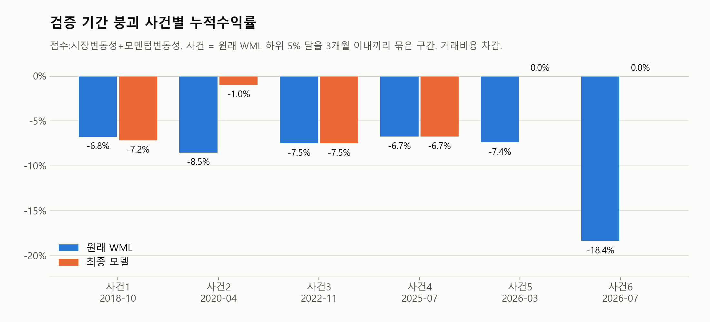
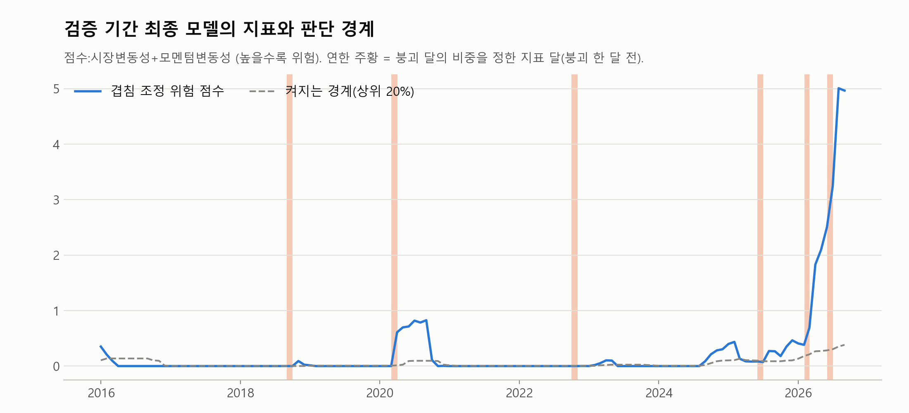
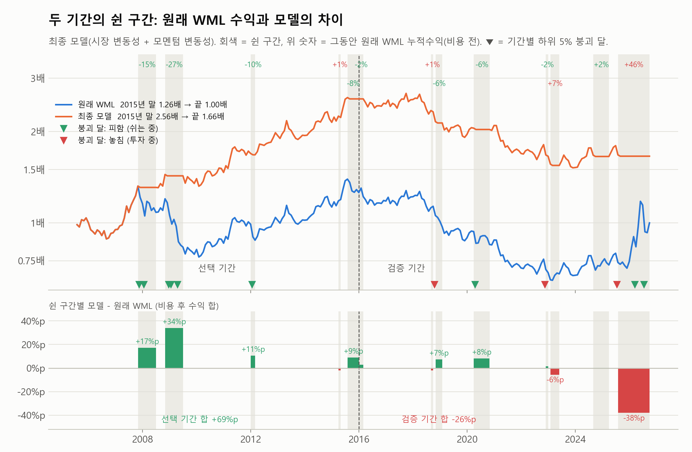

# 모멘텀 붕괴 연구 5. 진행 상황과 다음 단계

[README와 목차로 돌아가기](../README.md)

---

## 9. 일별 WML 결과와 다음 단계

### 9.1 일별 WML과 시장 (완료)

월별 WML과 같은 투자 대상과 바구니로 2000-01-04부터 2026-09-30까지 6,591거래일의 일별 수익률을 만들었다. 4가지 방식과 시장이 모두 들어 있다. 일별 값은 지표 계산에만 쓰며, 전략의 수익률은 계속 월별 WML을 쓴다.

**월별 값과 비교.** 일별 수익률을 달마다 복리로 합쳐 2000-01부터 2026-09까지 321개월을 월별 값과 비교했다. 1%p 넘게 차이 나는 달은 없다.

| 대상 | 월별 월평균 | 일별 합산 월평균 | 최대 차이 | 35% 규칙 없이 계산한 최대 차이 |
|---|---|---|---|---|
| 2×3 | 0.805% | 0.800% | 0.17%p | 0.13%p |
| 5×5 | 0.842% | 0.836% | 0.26%p | 0.18%p |
| 5분위 | 1.113% | 1.109% | 0.22%p | 0.03%p |
| 10분위 | 1.264% | 1.256% | 0.64%p | 0.23%p |
| 시장 | 0.883% | 0.883% | 0.02%p | 0.02%p |

**외부 값과 비교 (일별 상관)**

| 기간 | 시장과 코스피 지수 | 2×3 WML과 FnGuide 모멘텀 지수 |
|---|---|---|
| 2000-01부터 2026-09까지 | 0.991 | 0.941 |
| 선택 기간 | 0.995 | 0.949 |
| 검증 기간 | 0.993 | 0.931 |

**35% 규칙으로 지운 칸.** 투자 대상 약 1,168만 칸 중 86칸(상승 20, 하락 66)이다.

- 하락 66칸 중 64칸은 상폐 종목이고, 그중 60칸은 상장폐지일 직전 7거래일 안이다. 66칸 모두 그 달 월 수익률도 −31% 미만이어서, 일별 값만 튄 것이 아니라 실제로 크게 떨어진 달이다.
- 35% 규칙 없이 계산하면 2×3의 일별 합산 월평균이 0.805%로 월별과 같다. 따라서 일별 합산 월평균이 조금 낮은 것은 지운 칸 때문이며, 지운 칸의 대부분이 패자 쪽의 폭락이다. 이 손실은 전략 수익률인 월별 WML에는 그대로 남아 있다.
- 2015-07 이후 지운 칸은 하락 1칸뿐이다.

**지표를 볼 때 주의할 점.** 2026-07 말 기준으로 시가총액 상위 2개 종목의 비중이 시장의 약 50%다. 최근의 시장 변동성과 모멘텀 베타는 두 종목의 움직임을 크게 반영한다.

### 9.2 일별 시가총액과 거래대금 (완료)

비유동성 지표에 쓸 일별 시가총액과 거래대금을 일별 수익률과 같은 모양(6,860거래일 × 4,077종목)으로 정리했다. 확인 결과는 [1절](<1_데이터.md>)에 있다.

- **거래대금이 0인 날:** 그 달 말 투자 대상 종목의 그 달 거래일 중 0.30%이고, 대부분 수익률도 0이다. 2026-05는 2.48%로 높은데, 그 달 거래대금이 0인 날이 있는 126종목 중 106종목이 4월 말에 거래정지였고 117종목이 5월 첫날부터 0으로 시작한다. 거래정지가 풀리기 전의 날들이다.

### 9.3 지표 10개 (완료)

지표를 계산하기 전에 연구 설계([8절](<4_연구설계.md>))를 태그 `설계고정-2026-11-07`로 고정했다. 지표 달 1999-12부터 2026-08까지 매달 말 지표 10개와 정의 비교용 변형(약세장 2가지, CI 4가지, 비유동성 2가지)을 계산했다. t월 말 값은 t월 말까지의 자료로만 계산하고 t+1월 비중을 정하는 데 쓴다.

**계산하면서 정한 세부 규칙** (8절의 정의를 코드로 옮기며 정한 것)

- **일별 지표:** 시장 변동성, 모멘텀 변동성, 왜도, 베타는 t월 마지막 거래일까지 126거래일로 계산한다. 베타는 무위험수익률을 빼지 않는다(롱숏이라 상쇄되고 일별 값이 매우 작다).
- **왜도의 식:** 왜도는 (평균에서 벗어난 정도의 세제곱의 평균) ÷ (표준편차의 세제곱)이다([8절](<4_연구설계.md>)의 왜도 설명 참고). 표본이 작으면 이 값이 0 쪽으로 조금 작게 나오므로, 보통 일정한 배수를 곱해 바로잡는다(소표본 보정). 126일이면 배수가 약 1.012로 1.2% 차이이고, 신호는 순위로 정하므로 보정 여부와 상관없이 같다.
- **금융난류:** 평소 평균과 공분산은 t−1월까지의 값으로 구한다. t월이 평소와 얼마나 다른지 재는 지표라, t월이 기준에 섞이면 거리가 작아지기 때문이다.
- **비유동성:** 거래대금이 0인 날(분모가 0)과 일별 수익률 절댓값이 35%를 넘는 날(일별 WML과 같은 규칙)은 뺀다. 남은 날이 10일 미만이면 그 종목은 그달 값이 없다. 시장 비유동성은 t월 말 투자 대상을 t월 말 시가총액으로 가중평균한다.
- **비유동성 갭:** 형성기간은 점수와 같은 t−11월부터 t−1월까지이고, 11개월 중 6개월 이상 값이 있어야 한다. 11개월을 모두 요구하면 승자·패자 종목의 3.48%가 빠지지만 6개월이면 0.25%만 빠진다.

**점검**

| 점검 | 결과 |
|---|---|
| 빈 값 | 지표 달 2005-06(선택 기간 첫 비중을 정하는 달)부터 모든 지표에 빈 달이 없다 |
| 손계산 대조 | 2010-06의 모멘텀 갭, 베타, 시장 비유동성을 코드와 다른 방법으로 계산해 소수 열째 자리까지 같다 |
| 미래 정보 | 2008-10, 2015-12, 2020-03에서 그달 말 이후 자료를 지우고 다시 계산해도 20개 지표가 모두 같다 |
| 외부 대조 | 시장 변동성과 코스피 지수로 계산한 변동성의 상관이 0.998이다 |
| 비유동성이 덮는 종목 | 투자 대상의 평균 99.6%, 가장 낮은 달 94.6% |

**지표 모양에서 알 수 있는 점**

- **CI C와 D는 선택 기간에 5번만 켜진다.** "켜진 달 최소 6개" 조건([8절](<4_연구설계.md>) 8.4)에 못 미쳐 모델 비교 전에 걸러진다. A는 10번, B는 11번이다.
- **Amihud 버전은 시장 크기를 조정했다.** Amihud 비유동성 `|수익률| ÷ 거래대금(원)`은 시장 전체 하루 거래대금이 1999년 3.7조 원에서 2026년 42조 원으로 커지면서 저절로 작아진다. 조정하지 않으면 평균이 선택 기간 7.1e−5에서 검증 기간 1.2e−5로 약 6분의 1이 되어, "최근 60개월 중 위험한 쪽 20%" 규칙에 맞지 않는다. 그래서 [8절](<4_연구설계.md>)대로 시장이 커진 배수를 곱했다. 조정 후 평균은 선택 기간 1.5e−4, 검증 기간 5.2e−5다. 회전율 버전은 거래대금을 시가총액으로 나눠 시장 크기가 처음부터 없어지므로 9.1에서 5.8로 덜 줄었다.
- **비슷한 지표가 있다.** 상관계수는 두 지표가 달마다 함께 움직이는 정도로, 1이면 완전히 같이 움직이고 0이면 관계가 없다. 선택 기간에 시장 변동성과 모멘텀 변동성의 상관이 0.79로, 시장이 흔들리면 WML도 대개 함께 흔들려 두 지표의 정보가 많이 겹친다. 약세장 누적수익률과 모멘텀 베타는 0.58로, 시장이 2년간 올랐으면 승자에 시장에 민감한 종목이 많아져 WML의 베타가 양수가 되기 쉽다는 뜻이다.
- **9개 지표의 실제 정보는 3개에서 5개 정도다.** 주성분 분석은 여러 지표를 서로 겹치지 않는 새 축으로 다시 정리하는 방법이다. 조합 재료 9개를 정리하면 앞의 3개 축이 전체 움직임의 69%를 설명한다. 지표를 많이 섞어도 새 정보가 생각만큼 늘지 않는다는 뜻이다. 이 결과는 해석에만 쓰고 모델 선택에는 쓰지 않는다.

**이 단계에서 보지 않은 것:** 9.3에서는 지표와 다음 달 WML 수익률의 관계를 계산하지 않았다. 그 관계는 9.4에서 미리 정한 규칙으로 처음 계산했다.

### 9.4 선택 기간에서 모델 고르기 (완료)

[8절](<4_연구설계.md>)의 규칙대로 선택 기간(보유 달 2005-07부터 2015-12까지, 126개월)에서 모델 하나를 골랐다. 검증 기간의 성과는 계산하지 않았다. 고른 모델은 검증 전에 태그 `모델선택-2026-11-08`로 고정했다.

**최종 모델: 겹침 조정 위험 점수 (시장 변동성 + 모멘텀 변동성)**

두 지표의 위험 점수가 최근 60개월 중 상위 20%에 들면 다음 달 WML에 투자하지 않는다.

| 선택 기간 | 원래 WML (비용 전) | 원래 WML (비용 후) | 최종 모델 (비용 후) | 시장 |
|---|---|---|---|---|
| 월평균 | 0.81% | 0.27% | 0.80% | 0.82% |
| 샤프 비율 | 0.67 | 0.22 | 0.86 | 0.33 |
| 최대낙폭 | −32.4% | −41.6% | −14.8% | −48.2% |
| 붕괴 사건 누적수익률 합 | −51.1% | −55.1% | −2.0% | |
| 스패닝 알파 (NW t) | | | 월 0.63% (3.40) | |

- 모델 선택은 비용 후 값으로 했다. 비용 전 원래 WML은 시장과 월평균이 비슷하고 샤프는 두 배지만, 비용(월 0.54%p)을 빼면 크게 낮아진다.
- 시장의 샤프는 무위험수익률을 뺀 값이다. WML은 사는 만큼 공매도해 자기자금이 거의 없는 전략이라 무위험수익률을 빼지 않으며, 수익률을 시장과 그대로 비교하기는 어렵다.

- **쉰 달:** 24개월(2007-11부터 2008-06까지, 2008-11부터 2009-06까지, 2012-01, 2012-02, 2015-04, 2015-08부터 2015-12까지). 붕괴 달 6개를 모두 피했고, 사건 손실 −2.0%는 쉬기 위해 청산한 비용이다.
- **함께 보고할 모델:** 최고 단독은 시장 변동성(t 2.54), 최고 섞은 모델은 아래 과정의 t값 1위 모델(위험 점수: 시장 변동성 + 모멘텀 변동성 + 비유동성, t 3.64)이다.

**후보 57개는 어떻게 만들어졌나**

모델은 세 종류다.

| 종류 | 방식 | 개수 |
|---|---|---|
| **단독** | 지표 하나가 위험하면 쉰다 | 15 |
| **과반 규칙** | 여러 지표가 투표한다. 2개면 둘 다, 3개면 2개 이상, 4개면 3개 이상 켜지면 쉰다 | 21 |
| **위험 점수** | 여러 지표를 겹침 조정 위험 점수 하나로 합쳐 상위 20%면 쉰다 | 21 |
| **합계** | | **57** |

- **단독이 15개인 이유:** 조합 재료 9개와 CI(섞지 않고 단독으로만 씀)로 10개다. 여기에 지표 정의를 비교하려고 만든 다른 정의 5개(약세장 18개월, CI B·C·D, 비유동성 Amihud)도 후보로 남긴다.
- **과반 규칙과 위험 점수가 21개씩인 이유:** 두 방법의 조합은 "하나씩 추가하기"로 만들었다. 하나씩 추가하기는 모델 종류가 아니라 어떤 지표를 섞을지 고르는 절차다. 단독 1위(시장 변동성)에서 시작해 남은 8개를 하나씩 붙여 본 2개짜리 8개, 그중 1위에 남은 7개를 붙여 본 3개짜리 7개, 다시 6개를 붙여 본 4개짜리 6개로, 8 + 7 + 6 = 21개다. 9개 지표의 2개부터 4개까지 모든 조합(246개)을 다 시험하면 우연히 좋아 보이는 조합을 고르기 쉬워서 이렇게 줄였다.

**고른 과정**

1. **거르기:** 켜진 달이 6개 미만이거나 50%를 넘는 후보를 뺀다. 57개 중 47개가 남았다.
2. **지표 정의 고르기:** 약세장(24개월, 18개월), CI(A, B, C, D), 비유동성(회전율, Amihud)은 계산 방법이 여러 개라, 조합을 만들기 전에 하나로 정해야 한다. 정의마다 단독 전략으로 돌려 스패닝 알파 t값을 비교하고, 1위가 기본 정의보다 표준오차 1개를 넘게 높을 때만 바꾸기로 미리 정했다. 세 경우 모두 기본 정의가 1위여서 바꾸지 않았다(약세장 24개월 t 1.61 대 18개월 0.92, CI A 1.35 대 B 1.01, C와 D는 거르기 탈락, 비유동성 회전율 1.61 대 Amihud는 선택 기간에 4번만 켜져 거르기 탈락).
3. **하나씩 추가하기:** 위에서 설명한 대로 과반 규칙과 위험 점수 조합을 21개씩 만든다(경로는 아래 표).
4. **통과 심사:** 남은 후보를 원래 WML(비용 후)과 비교해 샤프 비율이 더 높고, 최대낙폭이 더 나쁘지 않고, 붕괴 사건 손실 합이 줄어든 것만 남긴다. 45개가 통과했다.
5. **순위:** 통과한 45개를 스패닝 알파 t값으로 줄 세운다. 1위는 위험 점수(시장 변동성 + 모멘텀 변동성 + 비유동성), t 3.64다.
6. **비슷하면 단순한 모델:** 1위와 t값 차이가 "표준오차 1개"보다 작은 후보는 1위와 사실상 같다고 본다. 그중 지표가 가장 적은 모델을, 지표 수도 같으면 최대낙폭이 가장 작은 모델을 고른다.

**6단계의 표준오차란**

- t값 차이가 작으면 그것이 실력 차이인지 운인지 알 수 없다. 표준오차는 "운만으로도 생길 수 있는 t값 차이의 크기"다.
- 구하는 방법(블록 부트스트랩): 선택 기간 126개월을 6개월 묶음으로 잘라, 묶음을 중복을 허용해 다시 뽑아 같은 길이의 가상 역사를 만든다. 이 가상 역사에서 1위와 다른 후보의 t값 차이를 계산한다. 이것을 5,000번 반복하면 차이가 얼마나 흔들리는지 알 수 있고, 그 흔들림(표준편차)이 표준오차다. 6개월 묶음으로 뽑는 것은 붕괴와 신호가 몇 달씩 몰려 있는 성질을 유지하기 위해서다.
- 예를 들어 최종 모델은 1위와의 t값 차이가 0.24(3.64 − 3.40)이고 표준오차가 0.39라, 다른 역사였다면 순서가 뒤바뀔 수 있을 만큼 작은 차이다. 반면 단독 시장 변동성은 차이가 1.10이고 표준오차가 0.73이라, 1위가 더 낫다고 볼 수 있다.

**6단계에서 1위와 사실상 같은 후보 8개** (번호는 아래 후보표의 순위)

| 순위 | 모델 | 지표 수 | t | 최대낙폭 |
|---|---|---|---|---|
| 1 | 위험 점수: 시장 변동성 + 모멘텀 변동성 + 비유동성 | 3 | 3.64 | −14.8% |
| 2 | 위험 점수: 시장 변동성 + 모멘텀 변동성 + 비유동성 + 모멘텀 갭 | 4 | 3.48 | −14.8% |
| **3** | **위험 점수: 시장 변동성 + 모멘텀 변동성 (최종)** | **2** | **3.40** | **−14.8%** |
| 6 | 위험 점수: 시장 변동성 + 모멘텀 변동성 + 비유동성 + 약세장 | 4 | 2.60 | −15.7% |
| 21 | 과반 규칙: 시장 변동성 + 모멘텀 베타 | 2 | 1.71 | −20.3% |
| 22 | 과반 규칙: 시장 변동성 + 약세장 | 2 | 1.71 | −20.3% |
| 26 | 과반 규칙: 시장 변동성 + 모멘텀 변동성 + 비유동성 + 약세장 | 4 | 1.59 | −20.3% |
| 27 | 과반 규칙: 시장 변동성 + 모멘텀 변동성 + 비유동성 + 모멘텀 베타 | 4 | 1.59 | −20.3% |

- 지표가 가장 적은 것은 2개짜리 3개(3위, 21위, 22위)이고, 그중 최대낙폭이 가장 작은 3위가 최종 모델이다.
- 21위, 22위, 26위, 27위는 t값이 1위보다 2 가까이 낮은데도 같은 무리에 들었다. 9번 이하로만 켜지는 모델이라 가상 역사마다 t값이 크게 흔들려 표준오차가 2.1부터 2.3까지로 컸기 때문이다. 실력이 비슷해서라기보다 "더 낫다고 말할 근거가 부족해서" 들어간 것이다.

**왜 지표가 적은 모델을 고르나**

지표가 많을수록 좋을 것 같지만, 지표를 하나 더할 때마다 "여러 개를 붙여 보고 가장 좋은 것"을 고르므로 지표가 많은 모델일수록 선택 기간의 우연에 더 맞춰져 있다. 기출문제를 많이 외운 학생이 기출에서는 점수가 높아도 새 문제에서는 떨어지기 쉬운 것과 같다. 그래서 성능이 사실상 같다면 단순한 모델이 새 기간에서 더 잘 버틸 가능성이 크다. 이것이 Hastie 외 (2009)의 "1 표준오차 규칙"의 생각이다.

**후보 57개 전체** (선택 기간, 거래비용 후, t값 순서)

표의 "결과" 칸에서 거르기 탈락은 켜진 달이 6개 미만이거나 50%를 넘은 후보이고, 심사 탈락은 샤프·최대낙폭·사건 손실 중 원래 WML보다 나빠진 항목을 적었다. 알파는 월 단위다.

- **붕괴 포착:** 붕괴 달 6개 중 쉬고 있던 달 수다. **정확도:** 쉰 달 중 실제 붕괴 달의 비율이다. 항상 쉬면 포착이 6/6이 되므로 두 값을 함께 본다.
- 붕괴 달은 원래 WML 하위 5%로 끝난 뒤 정한 것이라, 포착은 "맞혔다"보다 "그 달에 쉬고 있었다"는 뜻이다. 두 값은 보고용이며 모델 선택에는 쓰지 않았다.
- 붕괴 달 6개 중 5개가 2007-11부터 2009-04까지에 있어, 금융위기 때 쉬었는지가 포착 대부분을 정한다.

표 펼치기

| 순위 | 모델 | 켜진 달 | 붕괴 포착 | 정확도 | 월평균 | 샤프 | 최대낙폭 | 사건 합 | 알파 | t | 결과 |
|---|---|---|---|---|---|---|---|---|---|---|---|
| | **원래 WML** | 0 | 0/6 | | 0.27% | 0.22 | −41.6% | −55.1% | | | 비교 기준 |
| 1 | 위험 점수: 시장 변동성 + 모멘텀 변동성 + 비유동성 | 28 | 6/6 | 21% | 0.86% | 0.94 | −14.8% | −1.0% | 0.69% | 3.64 | 통과 |
| 2 | 위험 점수: 시장 변동성 + 모멘텀 변동성 + 비유동성 + 모멘텀 갭 | 28 | 6/6 | 21% | 0.76% | 0.84 | −14.8% | 0.0% | 0.60% | 3.48 | 통과 |
| 3 | **위험 점수: 시장 변동성 + 모멘텀 변동성** | 24 | 6/6 | 25% | 0.80% | 0.86 | −14.8% | −2.0% | 0.63% | 3.40 | **최종** |
| 4 | 위험 점수: 시장 변동성 + 모멘텀 변동성 + 모멘텀 갭 | 23 | 5/6 | 22% | 0.66% | 0.69 | −15.7% | −9.2% | 0.49% | 2.75 | 통과 |
| 5 | 위험 점수: 시장 변동성 + 모멘텀 갭 | 19 | 6/6 | 32% | 0.68% | 0.73 | −14.8% | 0.0% | 0.51% | 2.69 | 통과 |
| 6 | 위험 점수: 시장 변동성 + 모멘텀 변동성 + 비유동성 + 약세장(24개월) | 30 | 5/6 | 17% | 0.68% | 0.76 | −15.7% | −10.2% | 0.53% | 2.60 | 통과 |
| 7 | 위험 점수: 시장 변동성 + 비유동성 | 17 | 5/6 | 29% | 0.68% | 0.69 | −16.8% | −9.2% | 0.49% | 2.54 | 통과 |
| 8 | 단독: 시장 변동성 | 17 | 5/6 | 29% | 0.68% | 0.69 | −16.8% | −9.2% | 0.49% | 2.54 | 통과 |
| 9 | 위험 점수: 시장 변동성 + 모멘텀 변동성 + 약세장(24개월) | 29 | 5/6 | 17% | 0.62% | 0.68 | −15.7% | −10.2% | 0.46% | 2.39 | 통과 |
| 10 | 과반 규칙: 시장 변동성 + 모멘텀 변동성 + 비유동성 | 12 | 5/6 | 42% | 0.60% | 0.60 | −16.8% | −10.2% | 0.41% | 2.27 | 통과 |
| 11 | 과반 규칙: 시장 변동성 + 모멘텀 변동성 + 금융난류 | 17 | 5/6 | 29% | 0.64% | 0.64 | −14.8% | −10.2% | 0.45% | 2.27 | 통과 |
| 12 | 단독: 모멘텀 변동성 | 29 | 5/6 | 17% | 0.55% | 0.60 | −15.7% | −9.2% | 0.39% | 2.21 | 통과 |
| 13 | 과반 규칙: 시장 변동성 + 모멘텀 변동성 + 모멘텀 갭 | 16 | 5/6 | 31% | 0.57% | 0.59 | −15.7% | −9.2% | 0.39% | 2.16 | 통과 |
| 14 | 과반 규칙: 시장 변동성 + 모멘텀 변동성 + 왜도 | 19 | 4/6 | 21% | 0.54% | 0.55 | −16.8% | −18.3% | 0.36% | 1.97 | 통과 |
| 15 | 과반 규칙: 시장 변동성 + 모멘텀 변동성 + 약세장(24개월) | 12 | 4/6 | 33% | 0.58% | 0.57 | −16.8% | −18.3% | 0.38% | 1.96 | 통과 |
| 16 | 과반 규칙: 시장 변동성 + 모멘텀 변동성 + 비유동성 갭 | 11 | 4/6 | 36% | 0.54% | 0.52 | −16.8% | −18.3% | 0.34% | 1.84 | 통과 |
| 17 | 과반 규칙: 시장 변동성 + 모멘텀 변동성 | 11 | 4/6 | 36% | 0.54% | 0.52 | −16.8% | −18.3% | 0.34% | 1.84 | 통과 |
| 18 | 위험 점수: 시장 변동성 + 약세장(24개월) | 24 | 4/6 | 17% | 0.50% | 0.52 | −18.5% | −18.3% | 0.33% | 1.83 | 통과 |
| 19 | 위험 점수: 시장 변동성 + 비유동성 갭 | 14 | 4/6 | 29% | 0.58% | 0.54 | −20.3% | −20.3% | 0.37% | 1.82 | 통과 |
| 20 | 위험 점수: 시장 변동성 + 모멘텀 변동성 + 비유동성 + 금융난류 | 23 | 4/6 | 17% | 0.51% | 0.51 | −17.9% | −19.7% | 0.33% | 1.72 | 통과 |
| 21 | 과반 규칙: 시장 변동성 + 모멘텀 베타 | 9 | 3/6 | 33% | 0.58% | 0.52 | −20.3% | −29.4% | 0.35% | 1.71 | 통과 |
| 22 | 과반 규칙: 시장 변동성 + 약세장(24개월) | 9 | 3/6 | 33% | 0.58% | 0.52 | −20.3% | −29.4% | 0.35% | 1.71 | 통과 |
| 23 | 위험 점수: 시장 변동성 + 모멘텀 변동성 + 금융난류 | 21 | 4/6 | 19% | 0.50% | 0.50 | −17.9% | −19.7% | 0.31% | 1.64 | 통과 |
| 24 | 단독: 비유동성 | 8 | 2/6 | 25% | 0.42% | 0.37 | −34.6% | −40.0% | 0.17% | 1.61 | 통과 |
| 25 | 단독: 약세장(24개월) | 24 | 3/6 | 12% | 0.52% | 0.50 | −20.3% | −29.4% | 0.32% | 1.61 | 통과 |
| 26 | 과반 규칙: 시장 변동성 + 모멘텀 변동성 + 비유동성 + 약세장(24개월) | 8 | 3/6 | 38% | 0.54% | 0.48 | −20.3% | −29.4% | 0.31% | 1.59 | 통과 |
| 27 | 과반 규칙: 시장 변동성 + 모멘텀 변동성 + 비유동성 + 모멘텀 베타 | 8 | 3/6 | 38% | 0.54% | 0.48 | −20.3% | −29.4% | 0.31% | 1.59 | 통과 |
| 28 | 과반 규칙: 시장 변동성 + 비유동성 | 3 | 2/6 | 67% | 0.41% | 0.36 | −34.9% | −40.0% | 0.16% | 1.59 | 거르기 탈락 |
| 29 | 단독: 모멘텀 갭 | 9 | 3/6 | 33% | 0.43% | 0.39 | −25.4% | −32.5% | 0.20% | 1.57 | 통과 |
| 30 | 과반 규칙: 시장 변동성 + 모멘텀 변동성 + 모멘텀 베타 | 18 | 4/6 | 22% | 0.48% | 0.48 | −16.8% | −18.3% | 0.29% | 1.47 | 통과 |
| 31 | 위험 점수: 시장 변동성 + 모멘텀 변동성 + 비유동성 갭 | 15 | 3/6 | 20% | 0.50% | 0.47 | −26.8% | −29.4% | 0.29% | 1.39 | 통과 |
| 32 | 과반 규칙: 시장 변동성 + 모멘텀 갭 | 3 | 2/6 | 67% | 0.41% | 0.35 | −30.2% | −40.8% | 0.15% | 1.36 | 거르기 탈락 |
| 33 | 단독: CI(A) | 10 | 2/6 | 20% | 0.37% | 0.33 | −33.3% | −45.2% | 0.13% | 1.35 | 통과 |
| 34 | 과반 규칙: 시장 변동성 + 모멘텀 변동성 + 비유동성 + 모멘텀 갭 | 4 | 2/6 | 50% | 0.43% | 0.37 | −28.2% | −40.0% | 0.18% | 1.34 | 거르기 탈락 |
| 35 | 위험 점수: 시장 변동성 + 모멘텀 변동성 + 비유동성 + 비유동성 갭 | 13 | 3/6 | 23% | 0.49% | 0.47 | −27.7% | −29.4% | 0.29% | 1.34 | 통과 |
| 36 | 위험 점수: 시장 변동성 + 모멘텀 변동성 + 비유동성 + 모멘텀 베타 | 33 | 5/6 | 15% | 0.41% | 0.47 | −15.7% | −10.2% | 0.27% | 1.28 | 통과 |
| 37 | 위험 점수: 시장 변동성 + 금융난류 | 18 | 4/6 | 22% | 0.44% | 0.44 | −17.9% | −19.7% | 0.25% | 1.27 | 통과 |
| 38 | 위험 점수: 시장 변동성 + 모멘텀 변동성 + 왜도 | 43 | 4/6 | 9% | 0.40% | 0.43 | −20.3% | −21.3% | 0.24% | 1.24 | 통과 |
| 39 | 위험 점수: 시장 변동성 + 모멘텀 변동성 + 모멘텀 베타 | 37 | 5/6 | 14% | 0.40% | 0.45 | −15.7% | −10.2% | 0.26% | 1.23 | 통과 |
| 40 | 위험 점수: 시장 변동성 + 왜도 | 44 | 4/6 | 9% | 0.39% | 0.43 | −20.3% | −21.3% | 0.24% | 1.22 | 통과 |
| 41 | 과반 규칙: 시장 변동성 + 모멘텀 변동성 + 비유동성 + 금융난류 | 7 | 3/6 | 43% | 0.42% | 0.39 | −27.7% | −30.1% | 0.20% | 1.10 | 통과 |
| 42 | 과반 규칙: 시장 변동성 + 모멘텀 변동성 + 비유동성 + 왜도 | 2 | 1/6 | 50% | 0.35% | 0.30 | −34.9% | −48.1% | 0.09% | 1.09 | 거르기 탈락 |
| 43 | 과반 규칙: 시장 변동성 + 모멘텀 변동성 + 비유동성 + 비유동성 갭 | 2 | 1/6 | 50% | 0.35% | 0.30 | −34.9% | −48.1% | 0.09% | 1.09 | 거르기 탈락 |
| 44 | 단독: CI(B) | 11 | 2/6 | 18% | 0.34% | 0.30 | −33.3% | −45.2% | 0.10% | 1.01 | 통과 |
| 45 | 단독: 약세장(18개월) | 24 | 3/6 | 12% | 0.38% | 0.36 | −22.8% | −29.4% | 0.18% | 0.92 | 통과 |
| 46 | 단독: CI(C) | 5 | 2/6 | 40% | 0.34% | 0.30 | −35.8% | −42.1% | 0.10% | 0.92 | 거르기 탈락 |
| 47 | 단독: 금융난류 | 22 | 3/6 | 14% | 0.32% | 0.32 | −28.2% | −32.7% | 0.13% | 0.85 | 통과 |
| 48 | 과반 규칙: 시장 변동성 + 금융난류 | 7 | 2/6 | 29% | 0.35% | 0.31 | −35.2% | −40.1% | 0.12% | 0.85 | 통과 |
| 49 | 단독: 모멘텀 베타 | 25 | 3/6 | 12% | 0.34% | 0.34 | −20.3% | −29.4% | 0.15% | 0.74 | 통과 |
| 50 | 위험 점수: 시장 변동성 + 모멘텀 베타 | 30 | 4/6 | 13% | 0.29% | 0.32 | −19.6% | −18.3% | 0.13% | 0.69 | 통과 |
| 51 | 단독: CI(D) | 5 | 2/6 | 40% | 0.32% | 0.28 | −35.8% | −42.1% | 0.07% | 0.68 | 거르기 탈락 |
| 52 | 위험 점수: 시장 변동성 + 모멘텀 변동성 + 비유동성 + 왜도 | 49 | 4/6 | 8% | 0.25% | 0.29 | −32.9% | −20.3% | 0.11% | 0.50 | 통과 |
| 53 | 단독: 비유동성(Amihud) | 4 | 0/6 | 0% | 0.25% | 0.21 | −40.8% | −55.4% | −0.02% | −0.82 | 거르기 탈락 |
| 54 | 단독: 비유동성 갭 | 12 | 0/6 | 0% | 0.18% | 0.15 | −41.7% | −55.1% | −0.08% | −1.20 | 심사 탈락(샤프·낙폭·사건) |
| 55 | 과반 규칙: 시장 변동성 + 왜도 | 0 | 0/6 |  | 0.27% | 0.22 | −41.6% | −55.1% | −0.00% | −1.23 | 거르기 탈락 |
| 56 | 과반 규칙: 시장 변동성 + 비유동성 갭 | 0 | 0/6 |  | 0.27% | 0.22 | −41.6% | −55.1% | −0.00% | −1.23 | 거르기 탈락 |
| 57 | 단독: 왜도 | 43 | 0/6 | 0% | −0.04% | −0.03 | −44.4% | −55.1% | −0.24% | −1.49 | 심사 탈락(샤프·낙폭·사건) |

**하나씩 추가하기의 경로**

각 단계에서 앞 단계 조합에 지표 하나를 붙여 본 결과다. 1단계는 단독 후보 중 t값 1위다.

**과반 규칙**

| 단계 | 시험한 조합 (t값, 굵게 = 다음 단계로 넘김, 괄호 = 거르기 탈락) |
|---|---|
| 1 | **시장 변동성 2.54** |
| 2 | **+모멘텀 변동성 1.84**, +약세장(24개월) 1.71, +모멘텀 베타 1.71, (+비유동성 1.59), (+모멘텀 갭 1.36), +금융난류 0.85, (+왜도 −1.23), (+비유동성 갭 −1.23) |
| 3 | **+비유동성 2.27**, +금융난류 2.27, +모멘텀 갭 2.16, +왜도 1.97, +약세장(24개월) 1.96, +비유동성 갭 1.84, +모멘텀 베타 1.47 |
| 4 | **+약세장(24개월) 1.59**, +모멘텀 베타 1.59, (+모멘텀 갭 1.34), +금융난류 1.10, (+왜도 1.09), (+비유동성 갭 1.09) |

**위험 점수**

| 단계 | 시험한 조합 (t값, 굵게 = 다음 단계로 넘김, 괄호 = 거르기 탈락) |
|---|---|
| 1 | **시장 변동성 2.54** |
| 2 | **+모멘텀 변동성 3.40**, +모멘텀 갭 2.69, +비유동성 2.54, +약세장(24개월) 1.83, +비유동성 갭 1.82, +금융난류 1.27, +왜도 1.22, +모멘텀 베타 0.69 |
| 3 | **+비유동성 3.64**, +모멘텀 갭 2.75, +약세장(24개월) 2.39, +금융난류 1.64, +비유동성 갭 1.39, +왜도 1.24, +모멘텀 베타 1.23 |
| 4 | **+모멘텀 갭 3.48**, +약세장(24개월) 2.60, +금융난류 1.72, +비유동성 갭 1.34, +모멘텀 베타 1.28, +왜도 0.50 |

**거래비용**

2×3 WML은 매달 승자 쪽과 패자 쪽을 합쳐 평균 1.08만큼 사고판다(최대 4). 편도 0.5%면 원래 WML의 비용은 월 0.54%p로, 월평균이 0.81%에서 0.27%로 줄어든다. 한 달 쉬려면 전부 팔고 다시 사야 해서 약 2%가 든다.

- **비용을 빼지 않는 이유:** 신호 전략은 쉴 때마다 전부 팔고 다시 사므로 매매가 많아질 수 있다. 비용을 빼면 자주 껐다 켰다 하는 모델이 부당하게 유리해진다. 또 거래비용이 모멘텀 수익을 크게 깎는다는 것은 알려진 문제다(Lesmond, Schill & Zhou 2004; Novy-Marx & Velikov 2016). 비용 0%, 0.25%, 1%의 결과는 강건성에서 함께 보고한다.
- **비용 후 WML도 시장에 더할 가치는 있다.** 비용 후 WML만 보면 샤프 0.22로 시장(0.33)보다 낮다. 하지만 WML은 사는 만큼 공매도해 자기자금이 거의 들지 않으므로, 시장 대신이 아니라 시장 위에 더하는 전략이다. 선택 기간에 비용 후 WML과 시장 초과수익률의 상관은 −0.02이고, 시장에 비용 후 WML을 같은 크기로 더하면 샤프가 0.33에서 0.40으로 오른다.
- 공매도 대여 비용은 반영하지 않았다.

**해석할 때 주의할 점**

- **t값은 부풀려져 있다.** 학생 57명이 운이 섞인 시험을 보면, 1등의 점수에는 실력과 함께 운도 가장 많이 들어가 있을 가능성이 크고, 같은 학생이 다시 시험을 보면 대개 점수가 내려간다. 모델도 같다. 57개 중 선택 기간에 가장 좋았던 모델을 골랐으므로 t 3.40에는 그 기간에 운 좋게 맞은 부분이 섞여 있다. 그래서 결론은 고를 때 쓰지 않은 검증 기간에서만 낸다.
- 개선의 대부분은 금융위기 동안 쉰 데서 나온다. 두 변동성이 함께 높았던 시기다.
- 위험 점수는 두 변동성이 모두 평균보다 낮으면 0이다. 그래서 조용한 시기가 길면 작은 양수 점수만으로도 켜진다(그림 4의 경계선이 0인 구간). "두 변동성 중 하나라도 장기 평균을 넘으면 쉰다"에 가까워진다.

**선택 기간 결과를 본 뒤 고친 계산 오류 두 가지**

1. **동점 처리:** "더 위험한 값이 20% 미만이면 켠다"는 위험 점수가 0인 달이 많을 때 0인 달도 켰다(일부 조합이 126개월 중 77개월 켜짐). "같거나 더 위험한 값(자기 포함)이 20% 이하이면 켠다"로 고쳤다. 동점이 없으면 두 규칙이 같아 단독 신호 16개는 바뀌지 않았다. 고치기 전의 최종 모델은 단독 모멘텀 변동성(t 2.21)이었고 2012-01 붕괴를 피하지 못했다.
2. **부트스트랩:** 표준오차를 구하는 가상 역사 5,000개 중 일부에서 t값을 계산할 수 없었다. 쉬는 달이 9번 이하인 후보는, 다시 뽑은 가상 역사에 쉬는 달이 하나도 안 들어가면 원래 WML과 수익률이 똑같아져 회귀의 잔차가 모두 0이 되기 때문이다(후보마다 5,000번 중 1번부터 5번까지). 처음 코드는 이런 반복이 하나라도 있으면 표준오차 전체를 빈칸으로 만들었고, 빈칸인 6개 후보는 6단계의 "사실상 같은 후보"에서 빠졌다. 계산할 수 있는 반복만으로 표준오차를 구하게 고친 뒤 14번을 다시 실행했다. 그 결과 2개짜리 2개(21위, 22위)와 4개짜리 2개(26위, 27위)가 새로 들어왔지만, 같은 2개짜리 중 최대낙폭이 더 작은 3위가 그대로 뽑혀 최종 모델은 바뀌지 않았다. 이 문서의 표와 그림은 모두 고친 뒤의 결과다.

**그림** (선택 기간만, 모델을 고른 뒤 한 번 그림)

### 9.5 검증 기간 시험 (완료)

태그 `모델선택-2026-11-08`로 고정한 최종 모델을 검증 기간(보유 달 2016-01부터 2026-09까지, 129개월)에 **한 번** 적용했다. 결과를 본 뒤 모델, 규칙, 비용, 기간을 바꾸지 않았다. 2016-01의 거래비용은 2015-12의 실제 비중(쉬는 중)에서 이어 계산했다. 계속 운용했다면 실제로 드는 비용이기 때문이다.

**점검:** 같은 함수로 선택 기간을 다시 계산해 후보 57개의 t값이 9.4와 모두 같았다. 최종 모델의 검증 기간 수익률과 알파 t를 반복문으로 따로 계산해도 같았다. 2018-10, 2020-03, 2026-06에서 그 뒤 지표를 지워도 신호가 같았다.

**결론: 실패.** [8절](<4_연구설계.md>) 8.6의 세 조건 중 샤프 비율을 맞추지 못했다.

| 검증 기간 (거래비용 후) | 원래 WML | 최종 모델 | 조건 |
|---|---|---|---|
| 월평균 | −0.08% (비용 전 0.46%) | −0.30% | |
| 샤프 비율 | −0.06 | −0.38 | 못 맞춤 |
| 최대낙폭 | −50.4% | −43.2% | 맞춤 |
| 붕괴 사건 누적수익률 합 | −55.4% | −22.4% | 맞춤 |
| 스패닝 알파 (NW t) | | 월 −0.27% (−1.53) | |

- **쉰 달:** 39개월(2016-01, 02, 2018-09, 2018-11부터 2019-01까지, 2020-04부터 10까지, 2022-12, 2023-02부터 05까지, 2024-09부터 2025-03까지, 2025-08부터 2026-09까지). 붕괴 달 6개 중 3개를 피했고, 쉰 달 중 붕괴 달은 8%다.
- **2025-12까지 끊으면 "방향만 맞음"**이다(샤프 −0.40 대 원래 −0.41, t −0.34). 2026년이 결과를 실패로 바꿨다.
- **함께 보고할 모델:** 최고 단독(시장 변동성)은 실패(t −0.84), 최고 섞은 모델(위험 점수: 시장 변동성 + 모멘텀 변동성 + 비유동성)도 실패(t −1.90)다.
- **후보 57개 전체:** 검증 t가 1.96을 넘은 후보는 0개, 양수인 후보는 4개다. 선택 기간에 통과 심사를 지난 45개 중 42개가 실패, 3개가 방향만 맞음이다. 최종 모델만 운이 나빴던 것이 아니다.

**검증 기간의 붕괴 사건** (원래 WML은 비용 전 승자 쪽, 패자 쪽 수익률. 패자 쪽이 양수면 공매도 손실)

| 붕괴 달 | 원래 WML (비용 후) | 최종 모델 | 승자 쪽 | 패자 쪽 | 모양 |
|---|---|---|---|---|---|
| 2018-10 | −6.8% | −7.2% (투자) | −22.7% | −16.5% | 시장 급락, 승자가 더 떨어짐 |
| 2020-04 | −8.5% | −1.0% (쉼) | +13.9% | +21.9% | 코로나 뒤 패자 급반등 |
| 2022-11 | −7.5% | −7.5% (투자) | +5.3% | +12.3% | 패자 반등 |
| 2025-07 | −6.7% | −6.7% (투자) | +1.3% | +7.7% | 패자 반등 |
| 2026-03 | −7.4% | 0.0% (쉼) | −14.5% | −7.6% | 승자 급락 |
| 2026-07 | −18.4% | 0.0% (쉼) | −19.6% | −1.8% | 승자 급락 |

**왜 실패했나**

1. **원래 WML에 지킬 수익이 거의 없었다.** 비용 전에는 월 0.46%였지만 비용을 빼면 −0.08%다.
2. **2026년에는 높은 변동성이 수익과 함께 왔다.** 2008년에는 변동성이 높을 때 WML이 무너졌지만, 2026년에는 삼성전자와 SK하이닉스 등 승자가 크게 오르며 변동성이 높아졌다. 모델은 2025-08부터 계속 쉬어 2026-03과 2026-07의 붕괴는 피했지만, 그 사이의 큰 상승을 모두 놓쳤다.
3. **변동성이 먼저 오르지 않은 붕괴는 잡지 못했다.** 변동성이 먼저 오른 2020-04와 2026년은 잡았지만, 한 달에 갑자기 터진 2018-10, 2022-11, 2025-07은 놓쳤다.
4. **켜진 달이 WML이 좋았던 달과 겹쳤다.** 아래 강건성에서 기준을 엄격하게(위험한 쪽 10%) 해 쉬는 달을 줄여도 결과가 더 나빴다. 너무 자주 켜진 것보다 켜진 시점 자체가 틀린 것이 문제다.

선택 기간의 개선은 금융위기 한 번에서 나왔고, 큰 위기가 없고 WML 자체도 약한 검증 기간에는 변동성 신호가 쉬는 비용과 놓친 수익을 넘지 못했다.

**두 기간을 쉰 구간으로 이어 보기** (검증 결과를 본 뒤의 설명용 분석, `32_탐색_쉰구간.py`)

최종 모델이 쉰 구간마다 원래 WML이 얼마를 벌거나 잃었고, 모델이 원래 WML보다 얼마나 앞섰는지 두 기간을 이어 본다. 선택 기간의 개선이 어디서 나왔고, 검증 기간에 어디서 무너졌는지 보기 위해서다. 위 결론은 바꾸지 않는다.

- **쉰 구간:** 비중이 0인 달이 이어진 묶음. 2015-08부터 2016-02까지 이어진 쉼은 2016-01에서 끊어 두 기간에 나눠 셌다.
- **차이:** 쉰 달들에서 (모델 비용 후 − 원래 WML 비용 후) 수익의 합(%p). 다시 들어가는 달의 구축 비용과 나오는 달의 청산 비용은 투자한 달에 붙으므로, 쉰 구간의 합은 전체 차이와 조금 다르다.

| 기간 | 쉰 구간 차이 합 | 투자한 달 차이 합 (구축·청산 비용) | 전체 차이 |
|---|---|---|---|
| 선택 기간 (구간 5개) | +68.7%p | −1.8%p | +67.0%p |
| 검증 기간 (구간 8개) | −25.7%p | −3.1%p | −28.8%p |

- **선택 기간:** 금융위기 두 구간(2007-11부터 2008-06까지 +17.1%p, 2008-11부터 2009-06까지 +34.1%p)이 +51.2%p로 대부분이다.
- **검증 기간:** 앞 7개 구간의 합은 +12.3%p였지만, 마지막 구간(2025-08부터 2026-09까지 14개월)에서 원래 WML이 +45.8% 오르는 동안 쉬어 −38.0%p가 됐다.
- **두 기간 모두 WML이 떨어질 때 쉰 경우가 많았다.** 구간 13개 중 8개에서 원래 WML이 음수였다. 다만 2025-12까지 샤프가 원래 WML과 거의 같았으므로(−0.40 대 −0.41), 검증 기간에는 나쁜 달을 골라 쉬었다기보다 덜 들고 있던 만큼만 덜 잃은 것에 가깝다.
- **놓친 붕괴 달 3개(2018-10, 2022-11, 2025-07)는 모두 그다음 달부터 쉬었다.** 붕괴가 지난 뒤에야 신호가 켜졌다(위 "왜 실패했나" 3번).

### 9.6 강건성 (완료)

가정을 바꿔도 결론이 같은지 보았다. 보고용이며 9.5의 결론은 바꾸지 않는다. 두 종류가 있다.

- **모델 고정형:** 최종 모델을 그대로 두고 평가 가정만 바꾼다.
- **선택 재실행형:** 가정을 바꾼 채 모델 고르기를 처음부터 다시 하고 뽑힌 모델을 검증한다. 가정마다 검증 기간을 다시 보는 것이라 결론에는 쓰지 않는다.

| 단계 | 바꾼 것 | 경우 | 선택 기간 | 검증 기간 |
|---|---|---|---|---|
| 1 | 거래비용 (편도 0%, 0.25%, 0.5%, 1%) | 4 | 모두 개선 | 모두 실패 |
| 2 | 붕괴 기준 (하위 5%·10%, 월 −10%, 묶음 2·3·6개월) | 5 | 모두 개선 | 모두 실패 |
| 3 | 신호 규칙 (판단 창 36·60·120개월, 위험한 쪽 10·20·30%, 시장 변동성 252일) | 6 | 모두 개선 | 모두 실패 |
| 4 | WML 구성 (2×3, 5×5, 5분위, 10분위) | 4 | 개선 2, 방향만 맞음 2 | 모두 실패 |
| 5 | 표본 (기본, 코스피 단독, 금융주 제외, 전체 종목 경계, 삼성전자·SK하이닉스 제외) | 5 | 모두 개선 | 모두 실패 |
| 6 | 섞는 지표 최대 3·4·5개 (선택 재실행) | 3 | 같은 모델 | 모두 실패 |

붕괴 사건 손실은 모든 경우에 줄었다. **"붕괴는 줄이지만, 그 대가로 놓치는 수익이 더 크다"**가 일관된 모습이다.

**1. 거래비용: 비용이 0이어도 검증은 실패다**

| 편도 비용 | 선택 샤프 (원래 → 모델) | 검증 샤프 (원래 → 모델) | 시장에 원래 WML을 더한 샤프: 선택 (시장 0.33) | 검증 (시장 0.54) |
|---|---|---|---|---|
| 0% | 0.67 → 1.37 | 0.35 → 0.20 | 0.68 | 0.54 |
| 0.25% | 0.45 → 1.12 | 0.15 → −0.10 | 0.54 | 0.45 |
| 0.5% | 0.22 → 0.86 | −0.06 → −0.38 | 0.40 | 0.35 |
| 1% | −0.23 → 0.33 | −0.47 → −0.94 | 0.13 | 0.17 |

- 비용이 0이어도 검증 기간에 모델(월 0.15%)이 원래 WML(월 0.46%)보다 나쁘다. 실패의 원인은 거래비용이 아니라 쉬는 동안 놓친 수익이다.
- 선택 기간에는 비용 0.5%까지 시장에 WML을 더할 가치가 있었다(상관 −0.02). 검증 기간에는 2026년에 승자 쪽이 시장과 함께 움직여 상관이 0.48로 올랐고, 비용이 0이어도 더할 가치가 없었다.
- 비용마다 모델을 다시 고르면, 비용 0%에서는 단독 금융난류가 뽑혀 검증에서 "방향만 맞음"(t 1.46)이었고, 0.25%부터 1%까지는 같은 최종 모델이 뽑혀 실패했다.

**2. 붕괴 기준과 위기 구간**

- 다섯 붕괴 기준 모두 판정이 같다. 검증의 실패는 샤프 조건 때문이라 붕괴를 어떻게 정의해도 바뀌지 않는다.
- 선택 기간을 금융위기 구간(2007-07부터 2009-06까지, 결과와 무관한 외부 기준)과 그 밖으로 나누면, 위기 때(24개월) 16개월을 쉬어 알파 월 1.47%(t 2.83), 위기 밖(102개월)에서는 8개월만 쉬어 알파 월 0.22%(t 1.53)였다. 선택 기간의 개선은 대부분 위기에서 나왔다.

**3. 신호 규칙**

- 판단 창이나 기준을 바꿔도 검증은 모두 실패다. 위험한 쪽 10%로 엄격하게 하면 검증 기간에 쉬는 달이 39개월에서 20개월로 줄지만 샤프는 −0.48로 더 나빴다.
- 시장 변동성을 252일로 길게 재면 가장 덜 나빴지만(검증 t −0.92) 여전히 실패다.
- 강건성 계산을 위해 13번 코드의 "20%"와 과반 규칙(5개는 3개 이상)을 바꿀 수 있게 했고, 본 결과의 신호는 바이트 단위로 같다.

**4. WML 구성 방식**

- 5분위와 10분위는 검증 기간에 원래 WML이 비용 후에도 양수(월 0.47%, 0.56%)인데, 모델을 적용하면 음수가 됐다. 지킬 수익이 있는 방식에서 손해가 더 컸다.
- 5분위와 10분위는 선택 기간에도 유의하지 않았다(t 1.72, 1.62). 선택 기간의 좋은 결과가 2×3에 맞춰져 있었다는 근거다.

**5. 표본**

- 금융주는 FnGuide 섹터 "금융"이며, 투자 대상 종목·월의 4.7%(시가총액 10.6%)다.
- 삼성전자와 SK하이닉스를 빼면 검증 기간 원래 WML의 비용 전 월평균이 0.46%에서 0.18%로 줄어든다. 이때 모델의 월평균은 원래와 거의 같지만(−0.35% 대 −0.36%) 샤프는 더 낮아 여전히 실패다. 2026년 두 종목의 상승만이 실패의 원인은 아니다.

**6. 선택 절차:** 섞는 지표를 최대 3개, 4개, 5개로 바꿔도 같은 최종 모델이 뽑혔다.

### 9.7 돌아보며

**자료와 시장의 한계**

- 선택 기간에 큰 위기가 사실상 금융위기 한 번이라, 무엇을 골라도 그 한 번에 맞춘 모델이 뽑히기 쉬웠다. 후보 45개가 통과 심사를 지났지만 대부분 같은 변동성 계열이라, 같은 내기를 45번 한 것에 가깝다.
- 한국 2×3 WML은 비용 후 수익이 작고, 2016년 이후에는 거의 없었다.
- 2026년에는 두 종목이 시장의 절반을 차지하면서 높은 변동성이 위험이 아니라 수익과 함께 왔다.

**설계에서 다르게 할 수 있었던 것**

1. **켜짐과 꺼짐(비중 0 또는 1)만 썼다.** 한 번 쉬는 데 약 2%가 들고 상승도 통째로 놓친다. Barroso & Santa-Clara (2015), Daniel & Moskowitz (2016)처럼 비중을 조금씩 줄였다 늘리면 비용과 틀렸을 때의 피해가 작다.
2. **"최근 60개월 중 상위 20%" 같은 상대 기준은** 위험의 절대 크기와 상관없이 일정한 비율로 켜지게 만든다.
3. **고르는 기준이 위기 한 번을 잘 맞힌 모델에 유리했다.** 여러 사건에서 고르게 도움이 됐는지, 위기 밖에서 손해가 없는지를 고르는 조건에 넣었다면 덜 과적합됐을 것이다.
4. **지표가 한국의 붕괴 모양과 맞지 않았을 수 있다.** 지표 대부분은 "약세장 뒤 반등 때 패자가 급등"하는 미국형 붕괴를 겨냥한다. 검증 기간 붕괴 6개 중 3개(2018-10, 2026-03, 2026-07)는 승자가 급락한 붕괴였다.

**그래도 의미 있는 점:** 규칙을 결과 전에 고정하고 검증 기간을 마지막까지 보지 않았기 때문에, "선택 기간의 큰 개선(샤프 0.22에서 0.86)이 표본 밖에서는 유지되지 않았다"는 결론을 믿을 수 있다. 이 결론은 비용, 붕괴 기준, 신호 규칙, WML 구성, 표본을 바꿔도 같다.

### 9.8 다음 단계

아래는 **아직 하지 않은 일**이다. 9.5의 결론은 바꾸지 않으며, 이후 실험은 모두 검증 결과를 본 뒤의 탐색으로 보고한다.

1. **설계에 약속한 보고 항목:** FF3 알파(SMB와 HML을 직접 만들어야 함), 샤프 차이 부트스트랩, 손익분기 거래비용, 평균-분산 비중
2. **확장 실험 ([8절](<4_연구설계.md>) 8.7):** 특히 3번(확률형·단계형 비중)과 5번(논문 전략과 비교). Barroso & Santa-Clara식 변동성 조절은 방법이 논문에 정해져 있어 검증 기간에 공정하게 비교할 수 있다.
3. **붕괴 유형 분석:** 승자 급락형과 패자 급등형을 나눠 어떤 지표가 어떤 붕괴를 잡는지 본다.

### 변경 기록

- **2026-11-08:** 비유동성 Amihud 버전은 처음에 시장 크기를 조정하지 않아 "최근 60개월" 비교 규칙에 맞지 않았다. 검증 전에 조정한 버전으로 바꿔 선택을 다시 했고, 최종 모델은 같았다(이전 결과: 태그 `모델선택-2026-11-07`, 다시 고른 결과: 태그 `모델선택-2026-11-08`).

---

**이전 문서:** [연구 설계 (8절)](<4_연구설계.md>)  
**다음 문서:** 없음 (마지막 문서)
