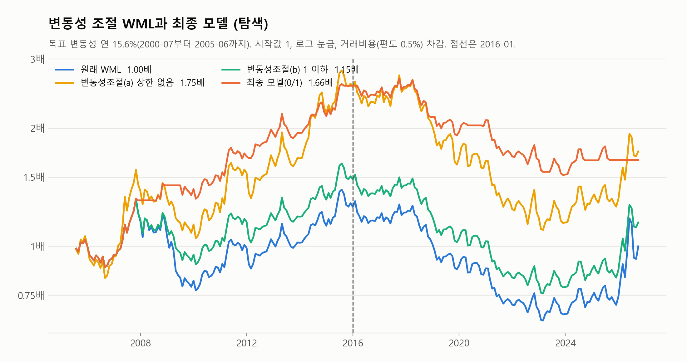
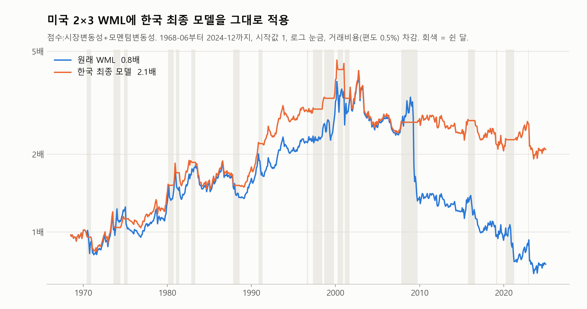
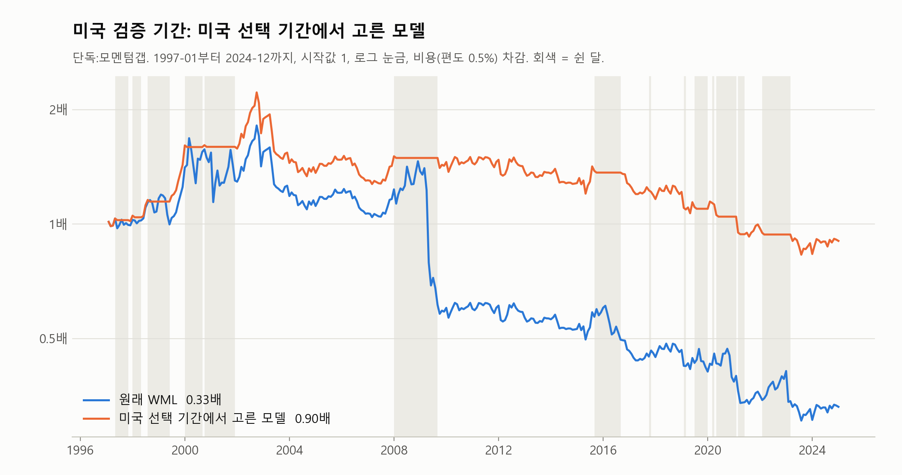

# 모멘텀 붕괴 연구 6. 검증 뒤 탐색과 종합 결론

[README와 목차로 돌아가기](../README.md)

---

## 10. 검증 뒤 탐색과 종합 결론

이 절의 실험은 모두 **검증 결과(9.5)를 본 뒤에** 한 탐색이다. 9.5의 판정("실패")은 바꾸지 않는다. 대신 실험마다 정의와 판정 기준을 돌리기 전에 정해 두었고, 결과를 보고 바꾸지 않았다. 거래비용은 모두 편도 0.5%이고, 판정 규칙(개선, 방향만 맞음, 실패)은 9.5와 같다.

### 10.1 논문의 변동성 조절 방식 (Barroso & Santa-Clara 2015)

0 또는 1로 쉬는 대신, 다음 달 비중을 "목표 변동성 ÷ 직전 126거래일 WML 변동성"으로 조금씩 조절했다. 목표 변동성은 선택 기간 전(2000-07부터 2005-06까지)의 WML 변동성(연 15.65%)으로 고정했다.

| 검증 기간 | 평균 비중 | 샤프 (원래 −0.06) | 최대낙폭 (원래 −50.4%) | 알파 t | 판정 |
|---|---|---|---|---|---|
| (a) 비중 상한 없음 (논문 그대로) | 1.37 | −0.11 | −59.6% | −0.82 | 실패 |
| (b) 비중 1 이하 | 0.98 | −0.10 | −50.2% | −1.15 | 실패 |
| 최종 모델 (0 또는 1) | 0.70 | −0.38 | −43.2% | −1.53 | 실패 |

검증 기간에는 WML 변동성이 목표보다 대체로 낮아, (a)는 비중을 키웠다가 손실이 커졌고 (b)는 2025년까지 거의 늘 비중 1이었다. 논문 방식도 한국 검증 기간을 개선하지 못했다.

### 10.2 붕괴 유형

전체 기간(2000-07부터 2026-09까지)의 원래 WML 하위 10%(32개월)를 붕괴 달로 보고, 그 달 WML 손실이 승자 하락에서 왔는지 패자 상승에서 왔는지로 나눴다.

- **패자 급등형 20개**(거의 모두 시장 상승 달), **승자 급락형 12개**(거의 모두 시장 하락 달).
- 붕괴 직전 달 말에 신호가 켜져 있던 비율(포착률)과 평소 켜짐 비율:

| 신호 | 평소 켜짐 | 승자 급락형 포착 | 패자 급등형 포착 |
|---|---|---|---|
| 최종 모델 | 22% | 6/10 | 7/16 |
| 시장 변동성 | 23% | 4/10 | 8/16 |
| 금융난류 | 23% | 3/10 | 8/16 |
| 약세장 24개월 | 21% | 1/11 | 9/18 |
| CI (4가지 정의) | 3%부터 12%까지 | 0/11 | 3, 4/18 |

- 약세장과 CI처럼 "약세장 뒤 반등"을 노리는 미국형 지표는 승자 급락형을 거의 잡지 못했다. 변동성 지표는 두 유형을 비슷하게 잡았다.
- 최종 모델은 붕괴 달을 평소의 약 2배 비율로 잡았지만, 붕괴가 아닌 달에도 자주 켜져 쉰 달의 대부분은 붕괴가 아니었다.

### 10.3 미국 자료로 시험

CRSP 자료(1962년부터 2024년까지, 저장소에 없음)로 미국 2×3 WML을 같은 방식으로 만들었다(NYSE 경계, 시가총액가중, 상장폐지 수익률 반영). Fama-French의 모멘텀 요인(UMD)과의 상관은 0.9992다.

**(1) 한국 최종 모델을 그대로 적용 (1968-06부터 2024-12까지)**

| 비용 | 샤프 (원래) | 최대낙폭 (원래) | 알파 t | 판정 |
|---|---|---|---|---|
| 0.5% | 0.17 (0.04) | −58.5% (−83.3%) | 1.46 | 방향만 맞음 |
| 0.25% | 0.41 (0.25) | −38.0% (−67.8%) | 2.04 | 개선 |

2009년 봄의 큰 붕괴(원래 −56.3%)를 6개월 모두 쉬어 피했다. 변동성이 먼저 오르지 않은 단발성 패자 반등(2002-11, 2023-01 등)은 못 피했다.

**(2) 고르는 방법 전체를 미국에 적용 (선택 1968-07부터 1996-12까지, 검증 1997-01부터 2024-12까지)**

선택 기간에 단독 모멘텀 갭이 뽑혔다(선택 t 1.24). 검증 기간 샤프 0.02(원래 −0.13), 최대낙폭 −62.6%(원래 −83.3%), 알파 t 0.61로 방향만 맞음. 후보 57개 중 검증 t가 1.96을 넘은 것은 0개였지만, 52개가 방향만 맞음이었다(한국은 통과 후보 45개 중 42개가 실패).

**(3) 한국과 같은 기간 (선택 2005-07부터 2015-12까지, 검증 2016-01부터 2024-12까지, 자료도 2000-01부터)**

- 이 시기 미국 WML도 비용 후 손실이었다(선택 기간 월 −0.40%). 붕괴 사건은 한국과 같이 3개였고, 1위 후보도 t 1.56으로 유의하지 않았다. 단독 약세장 18개월이 뽑혀 검증에서 방향만 맞음(t 1.08).
- 비교를 위해 한국 최종 모델을 한국에서 같은 2016-01부터 2024-12까지로 보면 **방향만 맞음**(t −0.26)이다. 한국의 "실패"는 2025년 이후, 특히 2026년에 생겼다. 미국은 이 기간 자료가 없어 비교할 수 없다.

### 10.4 롱온리와 시장 비중 틸트

실무에서는 WML을 그대로 사고팔기보다 공매도 없이 모멘텀 쪽으로 기울인다. 신호가 켜지면 다음 달 기울기를 끄고 시장(투자 대상 시가총액가중)을 들게 했고, 성과는 **시장 대비 수익**으로 쟀다. 현금으로 쉬면 시장 하락을 피한 효과가 섞여 붕괴 신호의 효과를 따로 볼 수 없어서다.

| 검증 기간, 시장 대비 | 원래 월평균 | 원래 정보비율 | 신호 붙인 정보비율 | 알파 t | 판정 |
|---|---|---|---|---|---|
| 승자 쪽 (소형 승자 + 대형 승자) | −0.53% | −0.67 | −0.69 | −1.33 | 실패 |
| 시장 비중 틸트 (MSCI 배수 방식) | +0.16% | 0.29 | −0.22 | −1.74 | 실패 |
| 대형 승자 | +0.11% | 0.17 | −0.21 | −1.53 | 실패 |

- 승자 쪽은 소형주를 시장보다 훨씬 많이 들어 "크기 베팅"이 섞였고, 초대형주가 시장을 끌어올린 2026년에 크게 뒤처졌다.
- **시장 비중 틸트**는 시가총액 비중에서 출발해 모멘텀 점수가 높은 종목은 늘리고 낮은 종목은 줄인다(배수 = 1 + z 또는 1 ÷ (1 − z), z는 점수의 단면 표준화). 시총 상위 10종목의 비중이 시장과 거의 같아 크기 베팅이 빠진다.
- 세 경우 모두 신호를 붙이면 선택 기간에는 좋아지지만 검증 기간에는 정보비율이 떨어졌다. WML과 같은 모양이다.

### 10.5 잔차 모멘텀

종목 수익에서 시장 몫을 뺀 잔차의 추세로 순위를 매기면 붕괴가 줄어든다는 연구가 있다(Blitz, Huij & Martens 2011). 원논문은 3요인 잔차를 쓰지만, 한국 SMB·HML을 아직 만들지 않아 시장 모형으로 대신했다. 판정 기준은 여러 번 시험한 뒤라 더 엄격하게 미리 정했다(t ≥ 3이면 "찾음", Harvey, Liu & Zhu 2016).

| 2005-07부터 2026-09까지, 시장 대비 | 월평균 | 정보비율 | t | 판정 |
|---|---|---|---|---|
| 보통 모멘텀 틸트 | 0.09% | 0.20 | 0.87 | 없음 |
| 잔차 모멘텀 틸트 | 0.00% | 0.01 | 0.07 | 없음 |

10.4에서 시장 비중 틸트가 검증 기간에 시장을 이긴 것(월 0.16%)도 t 0.88로 유의하지 않다.

### 10.6 종합 결론

1. **한국에서 위험 지표로 모멘텀 붕괴를 피하는 전략은 표본 밖에서 성과를 개선하지 못했다.** 손실과 낙폭은 거의 언제나 줄었지만, 쉬는 비용과 놓친 수익이 그보다 컸다. 논문의 변동성 조절, 롱온리, 시장 비중 틸트에서도 같다.
2. **선택 기간의 좋은 결과는 금융위기 한 번에 크게 기댔다.** 같은 시기 미국에서는 같은 방법으로도 유의한 모델이 나오지 않았다.
3. **방법 자체가 엉터리는 아니다.** 붕괴 사건이 많은 미국 장기 자료에서는 같은 모델과 같은 고르는 방법이 표본 밖에서도 붕괴를 막고 샤프를 조금 올렸다. 다만 비용 0.5%에서는 어느 시장에서도 유의하지 않았다.
4. **한국 검증 기간의 판정은 2025년 이후에 크게 좌우됐다.** 2024년까지는 "방향만 맞음"이었고, 2026년에 높은 변동성이 손실이 아니라 큰 수익과 함께 오면서 뒤집혔다.
5. **비용 0.5%를 가정하면, 이번에 시험한 모멘텀 계열에서 유의한 알파는 없었다.** WML, 롱온리, 시장 비중 틸트, 잔차 모멘텀 모두 그렇다.

### 10.7 돌아보며

**자료와 시장의 한계**

- 선택 기간에 큰 위기가 사실상 금융위기 한 번이라, 무엇을 골라도 그 한 번에 맞춘 모델이 뽑히기 쉬웠다. 후보 45개가 통과 심사를 지났지만 대부분 같은 변동성 계열이라, 같은 내기를 45번 한 것에 가깝다.
- 한국 2×3 WML은 비용 후 수익이 작고, 2016년 이후에는 거의 없었다.
- 2026년에는 두 종목이 시장의 절반을 차지하면서 높은 변동성이 위험이 아니라 수익과 함께 왔다.

**설계에서 다르게 할 수 있었던 것**

1. **켜짐과 꺼짐(비중 0 또는 1)만 썼다.** 한 번 쉬는 데 약 2%가 들고 상승도 통째로 놓친다. Barroso & Santa-Clara (2015), Daniel & Moskowitz (2016)처럼 비중을 조금씩 줄였다 늘리면 비용과 틀렸을 때의 피해가 작다. 다만 10.1에서 논문 방식으로 시험했지만 검증 기간에는 이것도 개선하지 못했다.
2. **"최근 60개월 중 상위 20%" 같은 상대 기준은** 위험의 절대 크기와 상관없이 일정한 비율로 켜지게 만든다.
3. **고르는 기준이 위기 한 번을 잘 맞힌 모델에 유리했다.** 여러 사건에서 고르게 도움이 됐는지, 위기 밖에서 손해가 없는지를 고르는 조건에 넣었다면 덜 과적합됐을 것이다.
4. **지표마다 잡는 붕괴가 다르다.** 전체 기간 붕괴 달(하위 10%, 32개월)은 패자 급등형 20개, 승자 급락형 12개다. 약세장과 CI 같은 미국형 지표는 승자 급락형을 거의 잡지 못했다. 변동성 지표는 두 유형을 비슷하게 잡았지만, 붕괴가 아닌 달에도 자주 켜져 쉰 달의 대부분이 붕괴가 아니었다(10.2).

**그래도 의미 있는 점:** 규칙을 결과 전에 고정하고 검증 기간을 마지막까지 보지 않았기 때문에, "선택 기간의 큰 개선(샤프 0.22에서 0.86)이 표본 밖에서는 유지되지 않았다"는 결론을 믿을 수 있다. 이 결론은 비용, 붕괴 기준, 신호 규칙, WML 구성, 표본을 바꿔도 같다.

### 10.8 추가 연구 가능성

이번 연구에서 하지 않았지만 이어서 해 볼 만한 것들이다.

**같은 모델을 새 자료로 다시 시험하기**

- 2026-10 이후 자료가 쌓이면 최종 모델을 그대로 다시 적용한다. 고르는 데 전혀 쓰지 않은 자료라 가장 깨끗한 표본 밖 시험이 된다.

**비중을 다르게 정하기**

- **확률형과 단계형 비중:** 실패의 큰 원인은 0 또는 1로 쉬면서 생긴 비용과 놓친 수익이었다(9.5). 붕괴 확률이나 위험 순위에 따라 비중을 단계적으로 줄이면 틀렸을 때의 피해가 작다. 붕괴 사례가 적으므로 지표 수는 제한해야 한다. 다만 10.1의 변동성 조절도 검증 기간에 실패했다.
- **안전할 때 비중 늘리기:** 켜짐과 꺼짐 두 상태만으로는 비중을 늘려도 달별 비중의 비율이 같아 거래비용 전 샤프와 스패닝 알파가 달라지지 않는다. 그래서 위험, 보통, 안전의 단계로 나눠 안전할 때 비중 1 초과를 허용한다. 10.1 (a)의 상한 없는 변동성 조절로 일부만 확인했다.

**다른 신호**

- **잘린 금융난류:** 자른 z에 금융난류 논문의 거리 계산을 응용한 `d = z⁺'Σ⁻¹z⁺`를 쓴다. 이 식은 "평소와 다른 정도"를 재므로, 상관이 0.8일 때 둘 다 위험한 (2, 2)는 4.4, 하나만 위험한 (2, 0)은 11.1로 하나만 튈 때 점수가 더 크다. 그래서 위험 점수로는 쓰지 않았지만, 함께 움직이던 지표가 어긋나는 것이 붕괴를 예고하는지 볼 수 있다. 지표가 2개이고 상관이 ρ이면 `d = (z₁² + z₂² − 2ρ·z₁·z₂) ÷ (1 − ρ²)`이다.
- **경기지수 약세장:** 이정택 (2016)처럼 경기지수로 약세장을 정의한다. 값이 사후에 수정돼 실시간 판단과 다를 수 있는 점에 주의한다.
- **CI 뒤집기:** Dierkes & Krupski (2022)의 논문 전략을 같은 자료로 만들어 최종 모델과 비교한다.

**다른 헤지 수단**

- **선물 헤지:** 롱온리에서 신호가 켜지면 코스피200 선물을 매도한다. 한국의 승자 급락형 붕괴는 거의 모두 시장 하락 달이라(10.2) 시장 위험을 덜어 내는 것이 도움이 될 수 있다. 시장이 반등하면 선물에서 손실이 나고, 선물 자료가 없으면 지수로 근사해야 한다.
- **옵션 헤지:** 과거 옵션 가격 자료가 필요하다.

**설계에 약속했지만 하지 않은 보고 항목**

- FF3 알파(SMB와 HML을 직접 만들어야 함), 샤프 차이 부트스트랩, 손익분기 거래비용, 평균-분산 비중, 금융난류 강건성(y를 10분위 수익률이나 승자와 패자로 바꾸기), 일부 수익·위험 지표(연기하평균, 칼마 등).
- SMB와 HML을 만들면 10.5의 잔차 모멘텀도 원논문처럼 3요인으로 다시 할 수 있다.

---

**이전 문서:** [실험 결과 (9절)](<5_진행상황.md>)  
**다음 문서:** 없음 (마지막 문서)
