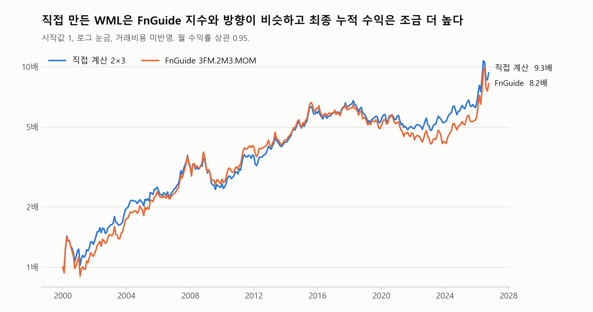
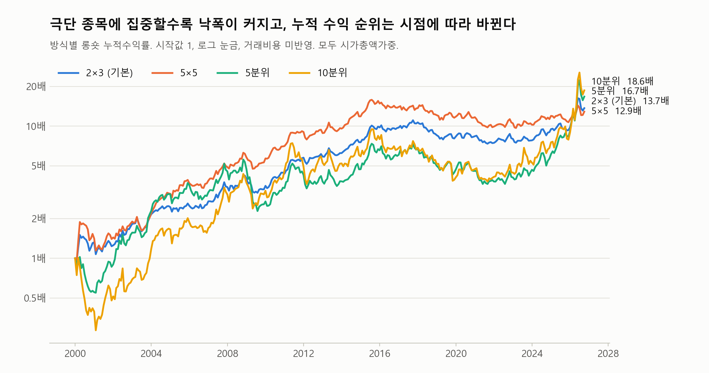
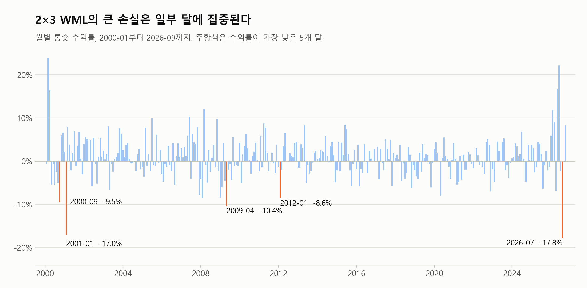

# 모멘텀 붕괴 연구 (파퀀 프로젝트)

최종 수정: 2026-11-05

## 0. 연구 소개와 요약

### 무엇을 연구하나

모멘텀 전략은 최근 많이 오른 종목(승자)을 사고 많이 내린 종목(패자)을 파는 전략이다. 평균 수익은 좋은 편이지만, 가끔 한 달 만에 크게 깨지는 경우가 있다. 이를 **모멘텀 붕괴**라고 부른다. 해외 연구에서는 하락장 뒤 시장이 반등할 때 패자가 급등하면서 붕괴가 일어나는 경우가 많다고 알려져 있다.

이 연구의 목표는 다음과 같다.

1. 한국 시장에서 모멘텀 붕괴를 정의한다.
2. 붕괴를 예측할 수 있는 지표들을 시험한다. 여러 지표의 조합을 비교해 가장 좋은 모델을 고른다. 예를 들어 지표가 4개면 4C1, 4C2, 4C3, 4C4를 모두 시험한다.
3. 그 모델로 붕괴를 피했을 때 성과가 실제로 좋아지는지 확인한다.

붕괴의 정의, 사용할 지표, 성과 기준은 아직 정하지 않았다.

### 지금까지 한 일

**1단계인 "분석에 쓸 모멘텀 수익률 만들기"까지 끝났다.** 붕괴 정의와 예측은 아직 시작하지 않았다.

- 코스피·코스닥 보통주(상폐 종목 포함)로 2000-01 ~ 2026-09의 월별 모멘텀 수익률을 계산했다(321개월).
- 2×3, 5×5, 5분위, 10분위의 4가지 방식으로 롱숏(WML)과 롱온리 수익률을 만들었다. 모두 시가총액가중이다.
- 기본 방식인 2×3은 FnGuide 모멘텀 지수와의 상관이 0.90으로, 대체로 같은 움직임을 보인다.

### 핵심 결과

| 방식 | 역할 | 롱숏 월평균 | t | 최대낙폭 | 최악의 달 | 2013년 이후 월평균 (t) |
|---|---|---|---|---|---|---|
| **2×3** | 기본 | 0.94% | 3.35 | −33.5% | −18.7% | 0.60% (1.81) |
| 5×5 | 강건성 확인 | 0.94% | 3.06 | −39.2% | −19.0% | 0.30% (1.00) |
| 5분위 | 강건성 확인 | 1.19% | 2.68 | −59.2% | −23.5% | 1.18% (1.97) |
| 10분위 | 강건성 확인 | 1.43% | 2.51 | −71.7% | −32.9% | 1.22% (1.60) |

- 전체 기간에서는 모든 방식의 평균 수익이 통계적으로 유의하다.
- **2013년 이후에는 성과가 약해진다.** 2×3, 5×5, 10분위의 t값이 1.96보다 낮고, 5분위만 1.97로 경계에 있다.
- 극단 종목에 집중할수록 평균 수익은 커지지만 손실도 커진다. 다만 누적 수익 순위는 2026년 급등의 영향을 크게 받는다.
- 최악의 달이 방식마다 달라서, 붕괴 연구에서는 방식에 따른 차이도 함께 봐야 한다.

---

## 1. 사용 데이터

FnGuide DataGuide에서 받은 엑셀을 사용한다. 원본 데이터는 저장소에 올리지 않는다.

### WML을 만드는 파일 10개

| 파일 | 내용 | 쓰임 |
|---|---|---|
| `03_월수익률_배당포함.xlsx` | 수정주가 기준 월 수익률(%), 현금배당 포함 | 모멘텀 점수, 보유 수익률 |
| `02_시가총액.xlsx` | 월말 시가총액(백만원) | 대형/소형 구분, 가중치 |
| `06_시장구분.xlsx` | KS(코스피), KQ(코스닥), EX(상장 전·상폐 후), KN(코넥스), K-OTC | 코스피·코스닥만 남김 |
| `04_거래정지.xlsx` | 정상/거래정지 | 거래정지 종목 제외 |
| `05_관리종목.xlsx` | 일반/관리 | 관리종목 제외 |
| `29_상장일_상폐일.xlsx` | 상장일, 상장폐지일 | 상폐 시점 확인, 재상장 구분 |
| `40`, `41`, `42` (`상폐종목_일간수정주가`) | 상폐 종목 1,376개의 일간 수정주가 | 상폐 수익률 계산 |
| `43_누락상폐종목_일간수정주가.xlsx` | K-OTC 종목 231개의 일간 수정주가 | 40~42번에 없는 상폐 종목 74개 보충 |

### 함께 준비한 파일 3개

| 파일 | 내용 | 쓰임 |
|---|---|---|
| `08_FF팩터지수.xlsx` | FnGuide 팩터 지수 70개(월말) | 직접 만든 WML과 비교 |
| `44_지수_일간.xlsx` | 코스피 등 일별 지수 | 시장 변동성 지표 후보(아직 안 씀) |
| `45_FF팩터지수_일간.xlsx` | FnGuide 모멘텀 지수 등 일별 값 | 모멘텀 변동성 지표 후보(아직 안 씀) |

### 데이터 점검 결과

- 02~06번은 종목 4,076개의 코드와 순서가 같고, 날짜도 1999-01 ~ 2026-10의 334개월로 빠진 달이 없다.
- 상장폐지일이 있는 종목은 1,451개이고, 이 중 1,450개는 40~43번에 일간 주가가 있다. 나머지 1개(`A101970`)는 상폐 후 재상장한 종목으로 보여 상폐 수익률 계산에서 제외했다.
- 04·05·06번은 상장 전후의 달에도 값이 채워져 있다. 따라서 상장 여부를 줄 수로 판단하면 안 되고, 시장구분이 `EX`인 달을 빼야 한다.

---

## 2. 분석 기간

**WML 수익률 기간은 2000-01 ~ 2026-09(321개월)이고, 첫 구성은 1999-12 말이다.**

- **시작:** 월 수익률이 1999-01부터 있다. 모멘텀 점수에는 11개월치 수익률이 모두 필요하므로 1999-11 말에는 점수를 계산할 수 없고, 1999-12 말에 처음 계산할 수 있다. 그때 조건을 통과하는 종목은 879개다.
- **끝:** 2026-10은 데이터 마지막 날이 10월 27일이라 온전한 한 달이 아니어서 제외했다.

---

## 3. 데이터 처리

DataGuide 엑셀은 위쪽에 머리글이 여러 줄 있고, 한 열에 글자와 숫자가 섞여 있어 그대로 계산할 수 없다. 그래서 두 단계로 처리했다.

1. **복사본 만들기:** 엑셀 13개를 표 모양 그대로 parquet 파일로 저장한다. 큰 엑셀을 매번 다시 읽지 않기 위한 단계다.
2. **표 정리:** 머리글과 데이터를 분리하고, 글자를 숫자로 바꾼다.

월별 파일은 다음과 같이 바뀐다. 숫자는 설명용 가상 값이다.

**정리 전**

| c0 | c1 | c2 |
|---|---|---|
| "코드" | "A000001" | "A000002" |
| "코드명" | "가나전자" | "다라화학" |
| "1999-01-29" | "1000.5" | "2000.5" |

**정리 후**

| 연월 | 종목코드 | 종목명 | 시가총액_백만원 |
|---|---|---|---|
| 1999-01 | A000001 | 가나전자 | 1000.5 |
| 1999-01 | A000002 | 다라화학 | 2000.5 |

**확인 결과:** 정리 전후로 값이 찬 칸 수가 같고, 숫자로 바꾸지 못한 값과 중복이 없다. 원본과 대표 값 19개를 비교해 모두 일치했다. 모든 값을 하나씩 비교한 것은 아니다.

---

## 4. 상폐 수익률

### 왜 필요한가

월 수익률은 월말 가격으로 계산한다. 그래서 월 중간에 상폐되면 그달 수익률이 빈칸이 된다. 빈칸을 그대로 두면 상폐 직전의 폭락이 빠져서, "전달 말 가격에 손해 없이 팔고 나간 것"처럼 계산된다.

### 계산 방법

상폐 종목의 일간 주가로 마지막 달의 수익률을 직접 계산한다. 아래는 가상 예시다.

| 항목 | 값 |
|---|---|
| 월별 수익률이 있는 마지막 달 | 3월 |
| 기준가: 3월 말 이하 마지막 일간 가격 | 1,000원 |
| 마지막가: 상장폐지일 전날까지의 마지막 일간 가격 | 100원 |
| **상폐 수익률** | 100 ÷ 1,000 − 1 = **−90%** |
| 반영하는 달 | 4월 |

### 예외 규칙

- 기준가 이후 거래가 없으면 0%로 둔다.
- +300%를 넘으면 수정주가 오류로 보고 가정값을 넣는다. 기준가가 없을 때도 가정값을 넣는다.
- 가정값은 실제로 계산된 값의 그룹 평균이다. 그룹은 마지막 달에 관리종목이거나 거래정지였는지(부실신호)로 나눈다. 평균은 부실신호 있음 −42.3%, 없음 −14.4%다.
- 상폐 후 재상장한 종목은 제외한다.

### 결과

대상 1,270종목의 평균은 −37.1%, 중앙값은 −9.3%, 범위는 −99.9% ~ +160.0%다.

| 처리 방식 | 전체 종목 수 | 분석 기간에 반영 | 평균 |
|---|---|---|---|
| 실제 가격으로 계산 | 1,195 | 1,123 | −39.4% |
| 거래 없음(0%) | 73 | 67 | 0.0% |
| +300% 초과로 가정값 | 2 | 2 | −42.3% |
| 기준가 없어 가정값 | 0 | 0 | |

### 약점과 영향

- **거래 없음(0%):** 실제로는 손실이 있었는데 0%로 잡혔을 수 있다. 하지만 분석 기간 67개 중 WML 바구니에 들어간 종목은 5개이고, **패자 쪽에는 하나도 없다.** 승자 쪽 종목을 모두 −100%로 바꿔도 WML 월평균은 방식에 따라 최대 0.003%p만 변한다.
- **가정값의 미래 정보:** 평균에 전체 기간의 값이 들어가므로 당시에는 알 수 없던 값이 섞인다. 다만 실제로 쓰인 것이 2개뿐이라 영향이 작을 것으로 본다. 계산해 비교하지는 않았다.

---

## 5. 월별 패널

시가총액, 수익률, 시장구분, 거래정지, 관리종목, 상폐 수익률을 **종목·월마다 한 줄**로 합쳤다. 결과는 632,184줄이다. 아래는 가상 예시다.

| 연월 | 종목코드 | 시가총액_백만원 | 수익률_% | 상폐반영 수익률_% | 상폐월 | 시장구분 |
|---|---|---|---|---|---|---|
| 2005-03 | A000001 | 50,000 | 3.0 | 3.0 | 거짓 | KQ |
| 2005-04 | A000001 | | | −90.0 | 참 | EX |

- **수익률 열:** 상폐를 반영하지 않은 값으로, 모멘텀 점수 계산에 쓴다.
- **상폐반영 수익률 열:** 상폐 수익률을 넣은 값으로, 보유 수익률에 쓴다.

**확인 결과**

- 시가총액, 수익률, 거래정지, 관리종목, 시장구분 값을 남은 줄 전부에 대해 원래 표와 비교했고 다른 칸이 없다.
- 시가총액은 있는데 수익률이 없는 줄이 7,169줄이다. K-OTC가 6,759줄로 대부분이고, 이런 줄은 투자 대상이 아니다.
- 투자 대상 조건을 통과한 종목·월 569,292개 중 다음 달 수익률이 없어 빠지는 경우는 3개뿐이다. 그래서 수익률 누락으로 생기는 왜곡은 사실상 없다.

---

## 6. WML 계산과 결과

### 계산 순서

2000-01 수익률을 예로 들면 다음과 같다.

1. **투자 대상 (1999-12 말):** 코스피·코스닥 종목 중 거래정지, 관리종목, 스팩이 아니고 시가총액이 있는 종목. 금융업은 포함한다.
2. **모멘텀 점수:** 직전 1개월을 뺀 그 전 11개월의 누적수익률이다(12−1 모멘텀). 1999-12 말 구성이면 1999-01 ~ 1999-11 수익률을 쓴다. 직전 달을 빼는 이유는 단기 반전 효과 때문이다.
3. **바구니 나누기:** 1999-12 말의 시가총액과 점수로 나눈다.
4. **보유 수익률:** 각 바구니의 2000-01 수익률을 1999-12 말 시가총액으로 가중 평균한다.
5. **WML:** 승자 쪽 − 패자 쪽.

매달 다시 구성하고 1개월 보유하며, 2026-09까지 반복한다.

### 4가지 방식

| 방식 | 역할 | 바구니 | 승자 쪽 (= 롱온리) | 패자 쪽 |
|---|---|---|---|---|
| **2×3** | 기본 | 크기 2(중앙값) × 모멘텀 3(30%·70%) | (소형 승자 + 대형 승자) ÷ 2 | (소형 패자 + 대형 패자) ÷ 2 |
| **5×5** | 강건성 확인 | 크기 5 × 모멘텀 5 | 크기 그룹별 최상위의 평균 | 크기 그룹별 최하위의 평균 |
| **5분위** | 강건성 확인 | 모멘텀 5 | 상위 20% | 하위 20% |
| **10분위** | 강건성 확인 | 모멘텀 10 | 상위 10% | 하위 10% |

- **역할은 결과를 보기 전에 정했다.** 여러 방식을 만들고 결과가 좋은 것을 고르면 우연히 좋게 나온 방식을 고를 위험이 크기 때문이다. 붕괴 정의, 지표 시험, 모델 선택은 2×3으로 하고, 나머지는 **결론이 방식을 바꿔도 유지되는지 보는 강건성 확인**에만 쓴다.
- **2×3을 기본으로 한 이유:** 성과가 가장 좋아서가 아니라, FnGuide와 비교할 수 있고 표준에 가까운 방식이기 때문이다.
- **동일가중은 만들지 않았다.** 초소형주의 영향이 커지고 실제로 투자하기 어렵기 때문이다.

### 검증: FnGuide 모멘텀 지수와 비교

전체 기간(321개월) 기준이다.

| 방식 | FnGuide 지수 | 상관 | 직접 계산 월평균 | FnGuide 월평균 | 차이의 NW t |
|---|---|---|---|---|---|
| 2×3 | `3FM.2M3.MOM` | 0.901 | 0.94% | 0.80% | 1.25 |
| 5×5 | `3FM.5M5.MOM` | 0.898 | 0.94% | 0.93% | 0.05 |

두 방식 모두 상관이 약 0.90이고 평균 차이도 유의하지 않다. 다만 추적오차가 월 2.3 ~ 2.5%로, 완전히 같은 수익률은 아니다. 작은 월평균 차이도 오래 쌓이면 벌어져서, 2×3의 누적수익은 직접 계산 13.7배, FnGuide 8.2배다.



**5분위와 10분위는 비교할 FnGuide 지수가 없어 외부 검증 없이 만든 결과다.** 2×3, 5×5와 같은 코드로 계산했고, 바구니 배정 합과 상관을 확인했다. 5분위와 10분위의 상관은 0.85, 10분위와 2×3의 상관은 0.76이다.

### 성과: 전체 기간 롱숏

- **NW t:** 수익률의 자기상관을 보정한 t값이다.
- **최대낙폭:** 누적수익률이 고점에서 가장 크게 떨어진 비율이다.
- **샤프:** 월평균 ÷ 월 표준편차 × √12. 무위험수익률은 빼지 않았다.

| 방식 | 월평균 | t | NW t | 샤프 | 최대낙폭 | 최악의 달 |
|---|---|---|---|---|---|---|
| 2×3 | 0.94% | 3.35 | 3.36 | 0.65 | −33.5% | −18.7% |
| 5×5 | 0.94% | 3.06 | 2.78 | 0.59 | −39.2% | −19.0% |
| 5분위 | 1.19% | 2.68 | 2.41 | 0.52 | −59.2% | −23.5% |
| 10분위 | 1.43% | 2.51 | 2.42 | 0.48 | −71.7% | −32.9% |

### 성과: 전반과 후반 롱숏

| 방식 | 2000-01 ~ 2012-12 월평균 (t) | 2013-01 ~ 2026-09 월평균 (t) |
|---|---|---|
| 2×3 | 1.30% (2.83) | 0.60% (1.81) |
| 5×5 | 1.62% (2.98) | 0.30% (1.00) |
| 5분위 | 1.19% (1.82) | 1.18% (1.97) |
| 10분위 | 1.65% (1.93) | 1.22% (1.60) |

### 누적수익률과 2026년의 영향



2025년 말까지는 5×5의 누적수익이 가장 높았지만, 2026년 급등으로 순위가 바뀌었다. 극단 종목에 집중한 방식일수록 2026년 영향이 크다.

| 방식 | 2025-12까지 누적 | 2026년 배수 | 2026-09까지 누적 | 2025-12까지 월평균 (t) | 2026-05 수익률 |
|---|---|---|---|---|---|
| 2×3 | 9.8배 | 1.40배 | 13.7배 | 0.84% (3.16) | +22.0% |
| 5×5 | 11.2배 | 1.15배 | 12.9배 | 0.92% (2.98) | +11.3% |
| 5분위 | 9.2배 | 1.82배 | 16.7배 | 0.97% (2.39) | +47.8% |
| 10분위 | 9.0배 | 2.08배 | 18.6배 | 1.15% (2.17) | +57.8% |

2025년 말까지만 보면 네 방식 모두 t값이 1.96보다 높지만, 월평균은 전체 기간보다 작다.

**2026년 급등의 원인은 삼성전자와 SK하이닉스다.** 2026-05 10분위 승자 쪽에서 두 종목의 비중이 63%이고, 수익률 43.9% 중 37.6%p를 두 종목이 냈다. 두 종목을 빼면 승자 쪽 수익률은 17.3%이고, 승자 쪽 종목의 수익률 중앙값은 −12.7%다. 두 종목의 수익률은 시가총액 변화와 같고, 같은 달 시장도 +24.4%, FnGuide 지수도 +25.7%라 데이터 오류일 가능성은 낮다고 본다. 다만 외부 자료로 검증한 것은 아니다.

### 성과: 롱온리와 패자 쪽

시장 수익률은 투자 대상 전체의 시가총액가중 수익률이다. 전체 기간 월평균 0.88%, 샤프 0.44, 최대낙폭 −52.7%다.

| 방식 | 롱온리 월평균 | 샤프 | 최대낙폭 | 시장과의 차이 (t) | 후반 시장과의 차이 (t) | 패자 쪽 월평균 |
|---|---|---|---|---|---|---|
| 2×3 | 1.54% | 0.72 | −51.9% | 0.66% (2.97) | 0.16% (0.65) | 0.60% |
| 5×5 | 1.37% | 0.54 | −55.5% | 0.49% (1.43) | −0.09% (−0.23) | 0.43% |
| 5분위 | 1.25% | 0.50 | −66.4% | 0.37% (1.79) | 0.44% (1.69) | 0.06% |
| 10분위 | 1.33% | 0.44 | −74.3% | 0.45% (1.37) | 0.58% (1.47) | −0.10% |

**주의:** 2×3과 5×5의 승자 쪽은 크기 그룹을 같은 비중으로 담아, 시총가중인 시장보다 소형주 비중이 크다. 그래서 시장과의 차이를 순수한 모멘텀 효과로 볼 수 없다.

### 방식별 최악의 달 5개 (롱숏)



| 방식 | 최악의 달 |
|---|---|
| 2×3 | 2001-01 −18.7%, 2026-07 −15.4%, 2000-09 −11.8%, 2009-04 −11.1%, 2009-01 −8.5% |
| 5×5 | 2001-01 −19.0%, 2000-09 −17.3%, 2026-07 −12.1%, 2009-04 −10.8%, 2003-04 −10.2% |
| 5분위 | 2009-04 −23.5%, 2026-07 −22.8%, 2000-04 −17.6%, 2019-10 −16.2%, 2000-06 −15.9% |
| 10분위 | 2002-07 −32.9%, 2001-01 −27.9%, 2019-10 −25.9%, 2000-01 −25.4%, 2026-07 −23.8% |

### 한계와 주의점

- **실제 투자 성과가 아니다.** 거래비용과 공매도 제약을 반영하지 않았다. 롱숏 수익률은 패자를 언제든 공매도할 수 있다는 가정의 값이다. 실제 투자 가능성을 볼 때 롱온리를 함께 보는 이유다.
- **최근 성과가 약하다.** 후반에는 대부분의 방식에서 유의하지 않아, 앞으로의 성과를 낙관하기 어렵다.
- **결과가 일부 달에 민감하다.** 2026년의 큰 수익이 전체 기간의 평균과 누적수익을 끌어올렸다. 예를 들어 10분위의 월평균은 2025년 말까지 1.15%, 2026-09까지 1.43%다. 시가총액가중이라 삼성전자와 SK하이닉스 같은 초대형주의 영향이 특히 크다.
- **붕괴의 원인이 항상 패자 급등은 아니다.** 2×3의 2026-07(−15.4%)은 패자 쪽이 −2.6%인데 승자 쪽이 −17.9%로, 승자 하락 때문에 깨졌다. 같은 달 삼성전자는 −21.4%, SK하이닉스는 −35.2%, 시장은 −22.3%다. 붕괴를 정의하고 원인을 볼 때 이 점을 함께 봐야 한다.
- **5×5는 바구니가 얇은 달이 있다.** 전체 8,025개 바구니·월 중 10개 미만이 42개이고, 최소는 2개다. 소형 승자와 대형 패자에서 주로 나타난다.
- **큰 월 수익률:** 월 +300% 초과가 201칸 있고, 그중 89칸이 WML 바구니에 들어가 그대로 두었다. 영향이 큰 7칸을 일간 주가로 확인했더니 한 번 튄 값이 아니라 여러 날에 걸친 상승이었다. 다만 같은 DataGuide 자료끼리 비교한 것이고, 나머지 칸은 확인하지 않았다. 모두 빼도 2×3 월평균은 0.94%에서 0.92%로 거의 변하지 않지만, 10분위의 2001-01은 −27.9%에서 −40.5%로 달라지는 등 일부 붕괴 달의 크기가 바뀔 수 있다.
- **시가총액이 일시적으로 작게 나올 수 있다.** 확인한 칸 중 3개는 가격이 하루에 크게 조정된 뒤에도(무상증자나 액면분할로 추정) 상장주식수가 그대로여서 시가총액이 작아졌다. 시가총액은 가중치와 대형/소형 구분에 쓰이므로 영향을 점검했다. 일시적으로 작게 나온 경우를 찾아 보정해도(투자 대상 종목·월의 0.13%) 2×3 월평균은 0.942%에서 0.947%로 거의 변하지 않고, 네 방식의 최악의 달 5개도 같았다. FnGuide와의 상관도 좋아지지 않아 보정하지 않았다. 다만 이 규칙이 못 잡은 경우가 있고, 그 영향은 재지 않았다.
- **수익률을 윈저화하지 않았다.** 극단값을 누르면 연구 대상인 붕괴 자체가 작아질 수 있기 때문이다.
- **수익률이 중간에 끊긴 종목이 13개 있다.** 그중 상폐 종목은 4개다. 다음 달 수익률이 없어 실제로 빠진 사례는 앞의 3개뿐이지만, 끊기기 전의 상폐 손실 자체는 확인하지 않았다.

---

## 7. 코드 실행 방법

`scripts/`의 코드를 번호 순서대로 실행한다. 원본 엑셀(`한국데이터/`)과 계산 결과(`처리데이터/`)는 저장소에 없으므로, 다시 돌리려면 DataGuide에서 1번 항목의 파일 13개를 받아 `한국데이터/`에 넣어야 한다.

| 순서 | 코드 | 입력 | 결과 |
|---|---|---|---|
| 1 | `01_엑셀캐시.py` | `한국데이터/`의 엑셀 13개 | `처리데이터/원본캐시/` |
| 2 | `02_표정리.py` | 복사본 13개 | `처리데이터/정리표/` |
| 3 | `03_상폐수익률.py` | 정리표 | `처리데이터/상폐수익률.parquet` |
| 4 | `04_월별패널.py` | 정리표, 상폐 수익률 | `처리데이터/월별패널.parquet` |
| 5 | `05_WML계산.py` | 월별 패널, 상폐 수익률, 08번 정리표 | `처리데이터/WML월별수익률.parquet`, `처리데이터/WML바구니수익률.parquet` |
| 6 | `06_WML그림.py` | WML 월별 수익률, 08번 정리표 | `결과/WML/`의 그림 3개 |

```text
python scripts/01_엑셀캐시.py
python scripts/02_표정리.py
python scripts/03_상폐수익률.py
python scripts/04_월별패널.py
python scripts/05_WML계산.py
python scripts/06_WML그림.py
```

- **환경:** Python 3.10에서 실행했다. `pandas`, `numpy`, `python_calamine`과 parquet를 읽고 쓰는 라이브러리(예: `pyarrow`)가 필요하다.
- **한글이 깨지면:** 환경 변수 `PYTHONIOENCODING=utf-8`을 설정한다.
- **문제 확인:** 02~05번 코드는 값 누락이나 중복 같은 문제를 찾으면 오류를 내고 멈춘다.

**WML 결과 표의 열**

- `WML월별수익률.parquet`: 연월, 방식, 롱숏_%, 롱온리_%, 패자쪽_%, 시장_%
- `WML바구니수익률.parquet`: 연월, 방식, 바구니, 수익률_%, 종목수

---

## 8. 다음 단계

아래는 **아직 하지 않은 일**이다.

1. **붕괴 정의:** 예를 들어 월 WML −10% 이하, 또는 하위 5%. 정의가 바뀌면 붕괴 달도 바뀐다.
2. **예측 지표 시험:** 아래는 아직 확정하지 않은 후보다. 관련 논문을 읽고 정의를 확인한 뒤 정한다.

   | 후보 지표 | 생각 | 참고 |
   |---|---|---|
   | 하락장 여부 | 붕괴는 하락장 뒤 반등에서 자주 일어남 | Daniel & Moskowitz (2016) |
   | 시장 변동성 | 하락장과 고변동성이 겹칠 때 위험이 큼 | Daniel & Moskowitz (2016) |
   | 모멘텀 자체의 변동성 | 변동성이 커지면 크게 깨질 가능성도 커짐 | Barroso & Santa-Clara (2015) |
   | 승자·패자의 베타 차이 | 하락장 뒤에는 패자가 고베타가 되어 반등 때 크게 깨짐 | Grundy & Martin (2001) |
   | 신용스프레드 | 위기 국면과 반등 초입을 보여 줄 수 있음 | |

3. **지표 조합 비교:** 여러 조합을 시험해 모델을 고른다. 붕괴 사례가 적어 과적합되기 쉬우므로, 앞 기간으로 만든 모델을 뒤 기간에서 시험하고, 그 시점에 알 수 있던 정보만 쓴다.
4. **성과 평가:** 모델로 붕괴를 피했을 때 롱숏과 롱온리의 성과가 좋아지는지 본다. 성과 기준은 아직 정하지 않았다.
5. **강건성 확인:** 2×3에서 나온 결론이 5×5, 5분위, 10분위에서도 유지되는지 본다.
